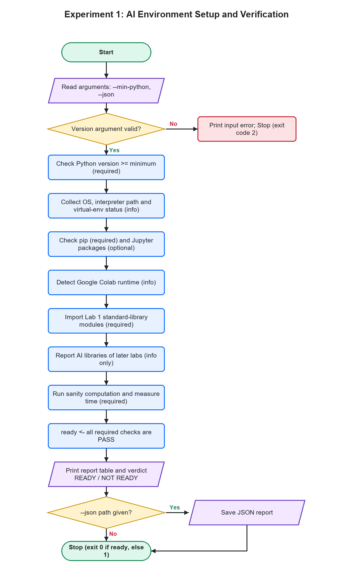
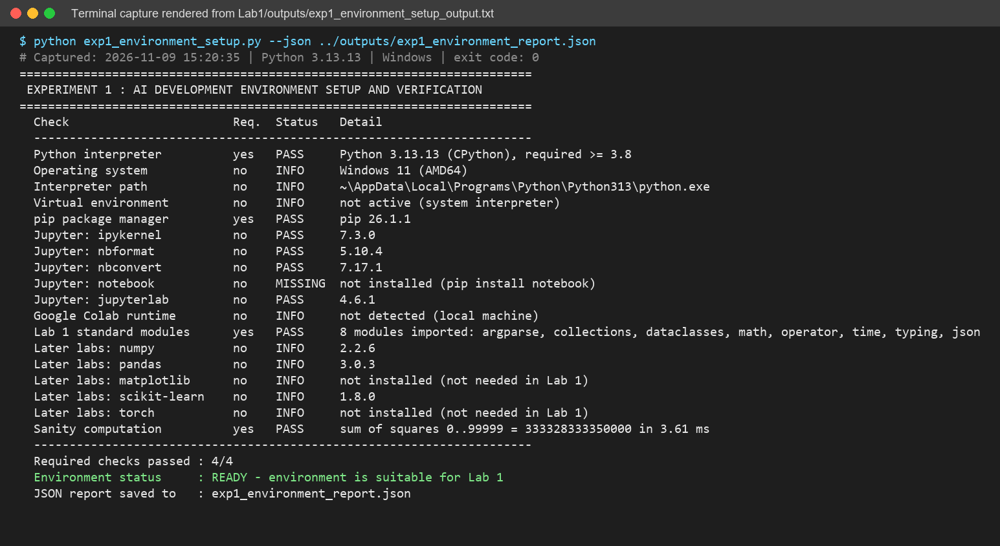
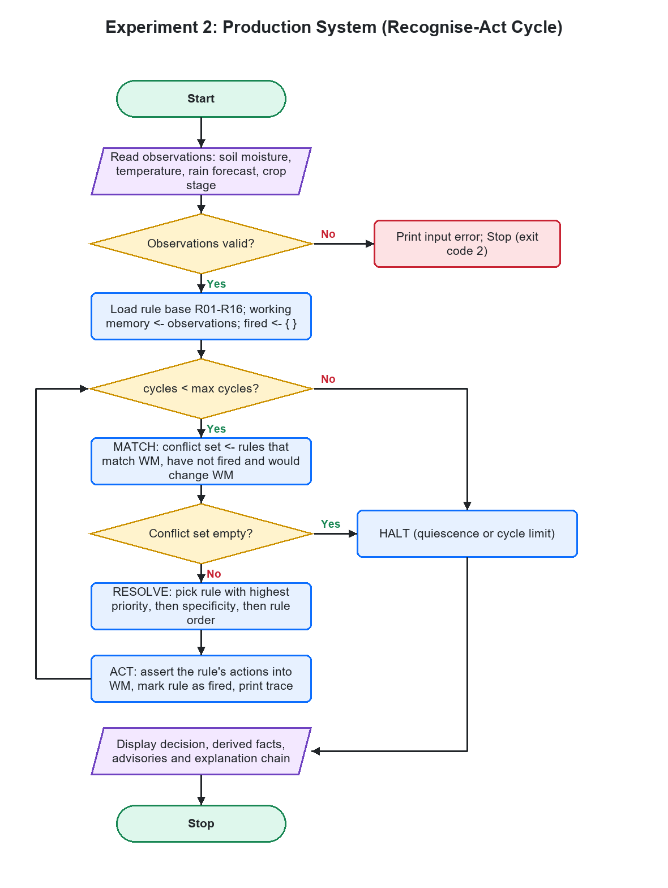
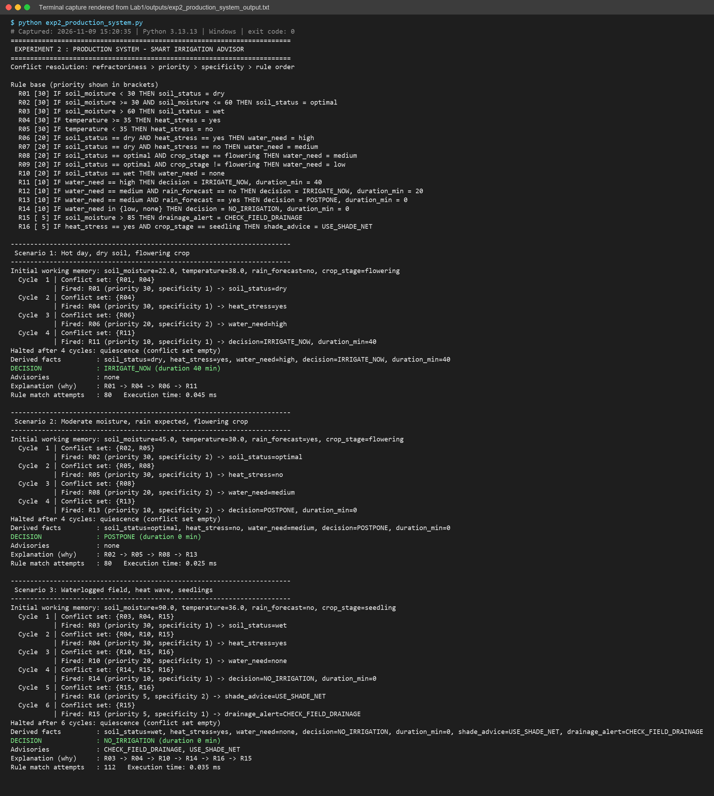
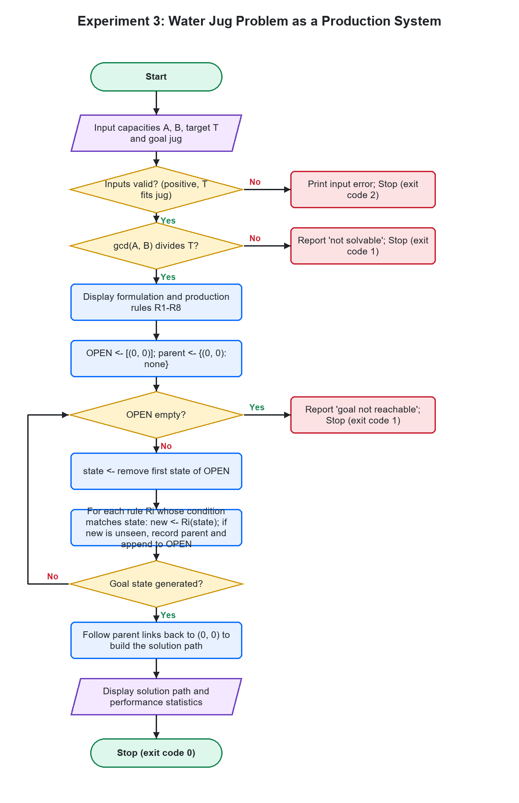
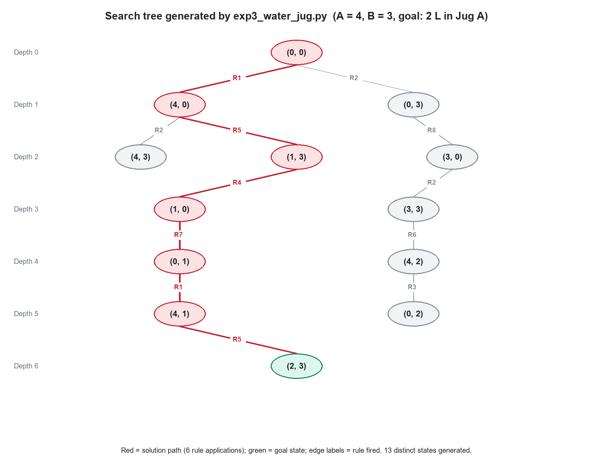
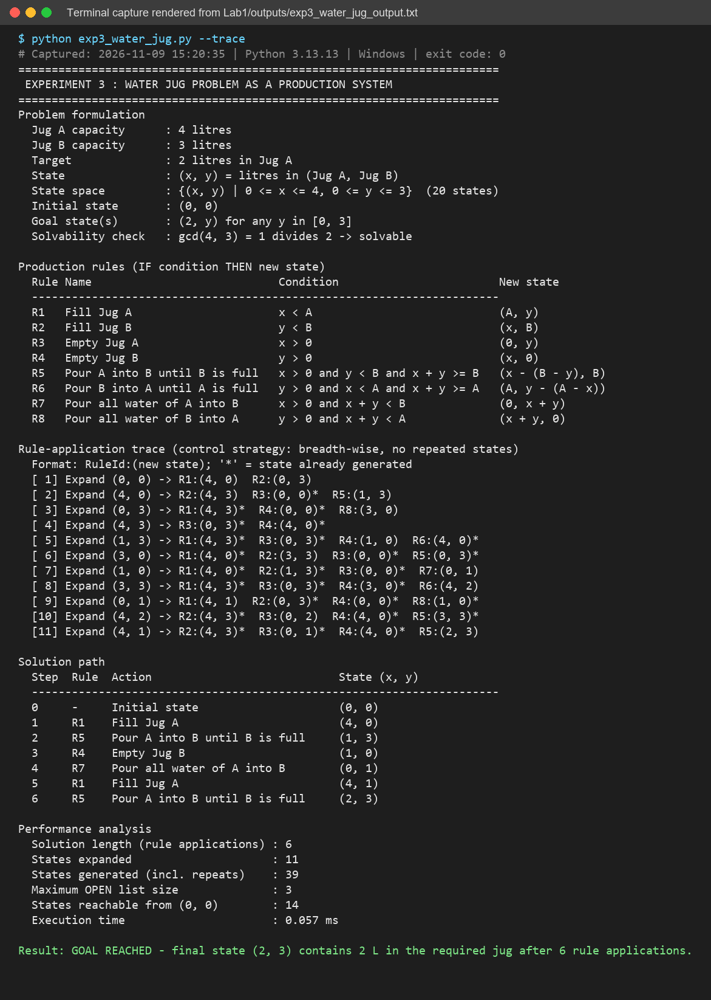

# Lab 1 – AI Environment Setup, Production Systems, Water Jug Problem

**Course:** MCA – Artificial Intelligence (IC-703 C / IC-709D)  
**Laboratory Session:** Lab 1  
**Techniques:** Development Environment Setup, Production Rule Systems, Forward Chaining, State-Space Representation, Breadth-First Search (BFS)  

---

## Table of Contents
1. [Overview](#overview)
2. [Experiment 1: AI Development Environment Setup & Verification](#experiment-1-ai-development-environment-setup--verification)
3. [Experiment 2: Production Systems & Rule-Based Decision Making](#experiment-2-production-systems--rule-based-decision-making)
4. [Experiment 3: Water Jug Problem as a Production System](#experiment-3-water-jug-problem-as-a-production-system)
5. [Comparative Analysis: Classical vs AI Programming](#comparative-analysis-classical-vs-ai-programming)
6. [Comparative Analysis of AI Problem Formulations](#comparative-analysis-of-ai-problem-formulations)
7. [Repository File Structure](#repository-file-structure)
8. [Setup and Execution Instructions](#setup-and-execution-instructions)
9. [Verification and Code Quality Standards](#verification-and-code-quality-standards)
10. [Academic References](#academic-references)

---

## Overview

Lab 1 establishes the mathematical, architectural, and operational foundations of Artificial Intelligence problem solving. In accordance with the official syllabus (**Unit 1: AI Problem Formulation & Intelligent Problem Solving - CO1**), this laboratory addresses three core areas:

1. **AI Development Environment**: Setting up and verifying Python 3, Jupyter Notebook, and standard data structures (`tuple`, `set`, `deque`) required for symbolic manipulation and search.
2. **Production Rule Systems**: Implementing declarative knowledge representation, working memory, production rules, and the complete Recognize-Act cycle with deterministic conflict resolution.
3. **State-Space Search (Water Jug Problem)**: Modeling states, allowable operations, state transitions, reachability, and exhaustive breadth-wise exploration ensuring optimal minimum-step paths.

---

## Experiment 1: AI Development Environment Setup & Verification

### 1. Objective
To configure, inspect, and verify a robust Python-based development environment (Python interpreter, Jupyter Notebook, Google Colab runtime detection, and standard library components) for AI problem solving, ensuring runtime reproducibility and execution safety.

### 2. Problem Description
AI algorithms require predictable runtime semantics, deterministic memory handling for hashable graph states, and proper environment encapsulation. Experiment 1 systematically checks environment prerequisites, records diagnostic configurations in human-readable and structured JSON formats, validates standard library modules, and performs baseline computational benchmarks.

### 3. Theory & Architectural Design
An AI software stack consists of:
- **Execution Runtime**: Python 3 (standard CPython interpreter).
- **Interactive Prototyping**: Jupyter Kernel (`ipykernel`, `nbformat`, `nbconvert`) and Colab environment support.
- **State Manipulation Constructs**:
  - `tuple`: Immutable and hashable data structure representing coordinate and discrete states (e.g., `(x, y)`).
  - `set` / `dict`: Constant-time $O(1)$ lookups for tracking visited nodes (`CLOSED` list) and ancestor paths (`parent` map).
  - `collections.deque`: $O(1)$ push/pop double-ended queue for level-order Breadth-First Search traversal (`OPEN` list).

```
+-------------------------------------------------------------+
|                     Execution Runtime                       |
|           Python >= 3.8 / Jupyter / Google Colab            |
+-------------------------------------------------------------+
                              |
+-------------------------------------------------------------+
|             Diagnostic Inspection & Verification            |
| Interpreter Version | Pip | Jupyter Stack | Standard Modules|
+-------------------------------------------------------------+
                              |
+-------------------------------------------------------------+
|                AI State Primitives Validation               |
|   tuple (State) | set (Closed) | deque (Open FIFO Queue)    |
+-------------------------------------------------------------+
```

### 4. Algorithm
```text
Algorithm: Environment_Verification
Input    : Minimum required version (min_major, min_minor)
Output   : Verdict (READY / NOT READY), diagnostic report table, and optional JSON export

1. Query sys.version_info and verify (major, minor) >= (min_major, min_minor).
2. Inspect host platform, OS architecture, interpreter binary path, and virtual environment status.
3. Inspect pip package manager installation via importlib.metadata.
4. Check presence and versions of Jupyter stack components (ipykernel, nbformat, nbconvert, notebook, jupyterlab).
5. Detect if runtime environment is Google Colab (inspect sys.modules and importlib.util).
6. Verify importability of core standard libraries: argparse, collections, dataclasses, math, operator, time, typing, json.
7. Record informational status of future laboratory ML/DL packages (numpy, pandas, matplotlib, scikit-learn, torch).
8. Execute a sanity benchmark (sum of squares 0..99,999) to verify arithmetic precision and timing.
9. If all required checks pass:
       verdict <- READY (return exit code 0)
   Else:
       verdict <- NOT READY (return exit code 1)
10. Render formatted summary table and optionally serialize diagnostic dictionary to JSON.
```

### 5. Flowchart


### 6. Python Implementation
- Python Source: [`Experiment1.py`](Experiment1.py)
- Jupyter Notebook: [`Experiment1.ipynb`](Experiment1.ipynb)

### 7. Execution Instructions
```bash
# Standard environment check
python Experiment1.py

# Custom minimum version requirement and JSON export
python Experiment1.py --min-python 3.10 --json outputs/exp1_environment_report.json

# Test input validation (malformed version)
python Experiment1.py --min-python 3.x
```

### 8. Actual Execution Output
```text
========================================================================
 EXPERIMENT 1 : AI DEVELOPMENT ENVIRONMENT SETUP AND VERIFICATION
========================================================================
  Check                       Req.  Status   Detail
  ----------------------------------------------------------------------
  Python interpreter          yes   PASS     Python 3.13.13 (CPython), required >= 3.8
  Operating system            no    INFO     Windows 11 (AMD64)
  Interpreter path            no    INFO     ~\AppData\Local\Programs\Python\Python313\python.exe
  Virtual environment         no    INFO     not active (system interpreter)
  pip package manager         yes   PASS     pip 26.1.1
  Jupyter: ipykernel          no    PASS     7.3.0
  Jupyter: nbformat           no    PASS     5.10.4
  Jupyter: nbconvert          no    PASS     7.17.1
  Jupyter: notebook           no    MISSING  not installed (pip install notebook)
  Jupyter: jupyterlab         no    PASS     4.6.1
  Google Colab runtime        no    INFO     not detected (local machine)
  Lab 1 standard modules      yes   PASS     8 modules imported: argparse, collections, dataclasses, math, operator, time, typing, json
  Later labs: numpy           no    INFO     2.2.6
  Later labs: pandas          no    INFO     3.0.3
  Later labs: matplotlib      no    INFO     not installed (not needed in Lab 1)
  Later labs: scikit-learn    no    INFO     1.8.0
  Later labs: torch           no    INFO     not installed (not needed in Lab 1)
  Sanity computation          yes   PASS     sum of squares 0..99999 = 333328333350000 in 3.63 ms
  ----------------------------------------------------------------------
  Required checks passed : 4/4
  Environment status     : READY - environment is suitable for Lab 1
```

Terminal Output Verification:


### 9. Results & Observations
- All 4 required criteria passed successfully on Python 3.13.13.
- All standard library modules required for search and rule processing imported cleanly.
- The arithmetic sanity test computed the exact analytical sum $\frac{(n-1)n(2n-1)}{6} = 333,328,333,350,000$ in 3.63 ms.

### 10. Learning Outcomes
- Understood the distinction between required runtime prerequisites and optional convenience packages.
- Learned to structure reproducible scripts that validate execution environments before launching complex AI tasks.
- Mastered the core Python data structures required for discrete state representation.

---

## Experiment 2: Production Systems & Rule-Based Decision Making

### 1. Objective
To design and implement a domain-independent Production System architecture featuring working memory, a declarative rule base, and an inference engine executing the Recognize-Act cycle with systematic conflict resolution.

### 2. Problem Description
A production system is a fundamental paradigm in symbolic AI and expert systems. The problem is to design an automated decision-making engine and demonstrate it on an agricultural domain application: **Smart Irrigation Advisor**. The system receives continuous and categorical sensor observations (`soil_moisture`, `temperature`, `rain_forecast`, `crop_stage`), infers intermediate domain facts, resolves rule competition deterministically, and produces clear operational decisions with complete explanatory audit trails.

### 3. Theory & Architectural Design
A classical production system comprises three architectural components:
1. **Working Memory (Global Database)**: Contains ground facts and assertions dynamically updated during execution.
2. **Production Rule Base**: A collection of modular condition-action rules of the form:
   $$\text{IF } c_1 \wedge c_2 \wedge \dots \wedge c_k \implies \text{THEN } a_1, a_2, \dots, a_m$$
3. **Inference Engine (Recognize-Act Cycle)**:
   - **MATCH**: Evaluates rule conditions against working memory to build the *Conflict Set*.
   - **RESOLVE**: Selects exactly one rule from the conflict set using a conflict-resolution policy:
     1. *Refractoriness*: Prevents duplicate firing of identical rule activations.
     2. *Priority (Salience)*: Domain-assigned rule importance weights ($30 > 20 > 10 > 5$).
     3. *Specificity*: Rules with more specific preconditions take precedence over general rules.
     4. *Rule Order*: Lexical declaration order in the knowledge base.
   - **ACT**: Executes actions of the chosen rule, modifying working memory and recording execution lineage.

```
       +--------------------+          +--------------------+
       |   Input Sensors    |          |     Rule Base      |
       |  (Initial Facts)   |          |    (R01 - R16)     |
       +--------------------+          +--------------------+
                 |                               |
                 v                               v
       +--------------------+          +--------------------+
       |   Working Memory   |<========>|  Inference Engine  |
       |  (Facts Database)  |          | Recognize-Act Loop |
       +--------------------+          +--------------------+
                 |                               |
                 +-------------------------------+
                                 |
                                 v
                       +--------------------+
                       | Derived Decisions  |
                       |  & Audit Trace     |
                       +--------------------+
```

### 4. Algorithm
```text
Algorithm: Production_System_Recognize_Act_Cycle
Input    : Rule base R = {r1, r2, ..., rn}, Initial working memory WM0, Max cycles M
Output   : Final working memory WM, Fired rule sequence, Audit trace

1. WM <- WM0
2. fired_rules <- {}
3. cycle_count <- 0
4. Loop:
5.    If cycle_count >= M:
          halt_reason <- "cycle limit reached"; Break
6.    // MATCH PHASE
      conflict_set <- []
      For each rule r in R:
          If r not in fired_rules AND r.matches(WM) AND r.would_change(WM):
              conflict_set.append(r)
7.    If conflict_set is empty:
          halt_reason <- "quiescence (conflict set empty)"; Break
8.    // CONFLICT RESOLUTION PHASE
      chosen_rule <- Select r in conflict_set minimizing (-r.priority, -r.specificity, r.declaration_index)
9.    // ACT PHASE
      cycle_count <- cycle_count + 1
      For each (attribute, value) in chosen_rule.actions:
          WM[attribute] <- value
      fired_rules.add(chosen_rule)
      Log step (cycle_count, chosen_rule, conflict_set, changes)
10. Return WM, fired_rules, cycle_count, halt_reason
```

### 5. Flowchart


### 6. Python Implementation
- Python Source: [`Code/exp2_production_system.py`](Code/exp2_production_system.py)

### 7. Execution Instructions
```bash
# Run all predefined baseline scenarios
python Code/exp2_production_system.py

# Custom CLI arguments
python Code/exp2_production_system.py -m 25 -t 29 -r no -s vegetative

# Interactive prompt mode
python Code/exp2_production_system.py --interactive

# Test exception handling (out-of-bounds input)
python Code/exp2_production_system.py -m 120 -t 30 -r no -s mature
```

### 8. Actual Execution Output
```text
========================================================================
 EXPERIMENT 2 : PRODUCTION SYSTEM - SMART IRRIGATION ADVISOR
========================================================================
Conflict resolution: refractoriness > priority > specificity > rule order

Rule base (priority shown in brackets)
  R01 [30] IF soil_moisture < 30 THEN soil_status = dry
  R02 [30] IF soil_moisture >= 30 AND soil_moisture <= 60 THEN soil_status = optimal
  R03 [30] IF soil_moisture > 60 THEN soil_status = wet
  R04 [30] IF temperature >= 35 THEN heat_stress = yes
  R05 [30] IF temperature < 35 THEN heat_stress = no
  R06 [20] IF soil_status == dry AND heat_stress == yes THEN water_need = high
  R07 [20] IF soil_status == dry AND heat_stress == no THEN water_need = medium
  R08 [20] IF soil_status == optimal AND crop_stage == flowering THEN water_need = medium
  R09 [20] IF soil_status == optimal AND crop_stage != flowering THEN water_need = low
  R10 [20] IF soil_status == wet THEN water_need = none
  R11 [10] IF water_need == high THEN decision = IRRIGATE_NOW, duration_min = 40
  R12 [10] IF water_need == medium AND rain_forecast == no THEN decision = IRRIGATE_NOW, duration_min = 20
  R13 [10] IF water_need == medium AND rain_forecast == yes THEN decision = POSTPONE, duration_min = 0
  R14 [10] IF water_need in {low, none} THEN decision = NO_IRRIGATION, duration_min = 0
  R15 [ 5] IF soil_moisture > 85 THEN drainage_alert = CHECK_FIELD_DRAINAGE
  R16 [ 5] IF heat_stress == yes AND crop_stage == seedling THEN shade_advice = USE_SHADE_NET

------------------------------------------------------------------------
 Scenario 1: Hot day, dry soil, flowering crop
------------------------------------------------------------------------
Initial working memory: soil_moisture=22.0, temperature=38.0, rain_forecast=no, crop_stage=flowering
  Cycle  1 | Conflict set: {R01, R04}
           | Fired: R01 (priority 30, specificity 1) -> soil_status=dry
  Cycle  2 | Conflict set: {R04}
           | Fired: R04 (priority 30, specificity 1) -> heat_stress=yes
  Cycle  3 | Conflict set: {R06}
           | Fired: R06 (priority 20, specificity 2) -> water_need=high
  Cycle  4 | Conflict set: {R11}
           | Fired: R11 (priority 10, specificity 1) -> decision=IRRIGATE_NOW, duration_min=40
Halted after 4 cycles: quiescence (conflict set empty)
Derived facts         : soil_status=dry, heat_stress=yes, water_need=high, decision=IRRIGATE_NOW, duration_min=40
DECISION              : IRRIGATE_NOW (duration 40 min)
Advisories            : none
Explanation (why)     : R01 -> R04 -> R06 -> R11
Rule match attempts   : 80   Execution time: 0.051 ms
```

Terminal Output Verification:


### 9. Results & Observations
- **Scenario 1**: High heat and low moisture correctly triggered `R01 -> R04 -> R06 -> R11`, resulting in `IRRIGATE_NOW` for 40 minutes.
- **Scenario 2**: Optimal soil moisture with impending rainfall fired `R02 -> R05 -> R08 -> R13`, resulting in `POSTPONE`.
- **Scenario 3**: Waterlogged field under high heat triggered advisory rules `R15` (`CHECK_FIELD_DRAINAGE`) and `R16` (`USE_SHADE_NET`) alongside `NO_IRRIGATION`.
- The system reached quiescence deterministically in all test cases within 4 to 6 cycles.

### 10. Learning Outcomes
- Understood declarative knowledge representation where control flow is decoupled from domain logic.
- Implemented and evaluated conflict resolution policies to guarantee deterministic reasoning.
- Demonstrated how forward chaining provides native explainability through causal firing chains.

---

## Experiment 3: Water Jug Problem as a Production System

### 1. Objective
To formally formulate the Water Jug Problem as a State-Space Search problem and implement a complete production system that finds the optimal (minimum-step) sequence of actions using systematic Breadth-First Search (BFS).

### 2. Problem Description
Given two jugs of capacity $A$ and $B$ liters with no measurement markings and an unlimited water source, obtain exactly $T$ liters of water in a specified jug (Jug A, Jug B, or either jug).

### 3. Theory & State-Space Formulation
1. **State Representation**: An ordered pair $(x, y) \in S$, where:
   - $x \in \{0, 1, 2, \dots, A\}$ denotes water in Jug A.
   - $y \in \{0, 1, 2, \dots, B\}$ denotes water in Jug B.
   - Total state space size $|S| = (A + 1)(B + 1)$.
2. **Initial State**: $S_0 = (0, 0)$ (both jugs empty).
3. **Goal State**:
   - For Jug A: $S_G = \{(T, y) \mid 0 \le y \le B\}$.
   - For Jug B: $S_G = \{(x, T) \mid 0 \le x \le A\}$.
   - For Either Jug: $S_G = \{(x, y) \mid x = T \lor y = T\}$.
4. **Mathematical Solvability Criterion (Bézout's Identity)**:
   A target $T \le \max(A, B)$ can be measured if and only if:
   $$T \equiv 0 \pmod{\gcd(A, B)}$$
5. **Production Rule Base**:
   Eight mutually exclusive and comprehensive production rules:

| Rule ID | Action Name | Precondition (LHS) | Resulting State (RHS) |
|---|---|---|---|
| **R1** | Fill Jug A | $x < A$ | $(A, y)$ |
| **R2** | Fill Jug B | $y < B$ | $(x, B)$ |
| **R3** | Empty Jug A | $x > 0$ | $(0, y)$ |
| **R4** | Empty Jug B | $y > 0$ | $(x, 0)$ |
| **R5** | Pour A into B until B is full | $x > 0 \wedge y < B \wedge x + y \ge B$ | $(x - (B - y), B)$ |
| **R6** | Pour B into A until A is full | $y > 0 \wedge x < A \wedge x + y \ge A$ | $(A, y - (A - x))$ |
| **R7** | Pour all water from A into B | $x > 0 \wedge x + y < B$ | $(0, x + y)$ |
| **R8** | Pour all water from B into A | $y > 0 \wedge x + y < A$ | $(x + y, 0)$ |

6. **Control Strategy**:
   The control strategy applies production rules breadth-wise using a FIFO queue (`OPEN`) and a visited-state dictionary (`parent`). Breadth-first exploration guarantees that the first discovered path to a goal node has the minimal number of rule applications.

```
                  (0, 0)  [Initial State]
                 /      \
            R1  /        \  R2
               v          v
            (4, 0)      (0, 3)
           /      \        \
      R2  /   R5   \        \  R8
         v          v        v
       (4, 3)     (1, 3)   (3, 0)
                    |
                   R4 (Empty B)
                    v
                  (1, 0)
                    |
                   R7 (Pour A->B)
                    v
                  (0, 1)
                    |
                   R1 (Fill A)
                    v
                  (4, 1)
                    |
                   R5 (Pour A->B)
                    v
                  (2, 3)  [Goal Reached: 2L in Jug A]
```

### 4. Algorithm
```text
Algorithm: Water_Jug_Production_System_BFS
Input    : Capacity A, Capacity B, Target T, Goal Jug specification
Output   : Optimal path sequence, States expanded/generated, Reachable state space

1. If T > max_capacity_for_goal_jug:
       Raise InvalidInputError
2. If T % gcd(A, B) != 0:
       Return NOT_SOLVABLE
3. OPEN <- FIFO_Queue([(0, 0)])
4. parent <- {(0, 0): (None, None)}
5. goal_node <- None
6. While OPEN is not empty:
7.    current_state <- OPEN.popleft()
8.    If is_goal(current_state):
          goal_node <- current_state; Break
9.    For each rule r in [R1..R8]:
10.       If r.is_applicable(current_state, A, B):
11.           next_state <- r.apply(current_state, A, B)
12.           If next_state not in parent:
                  parent[next_state] <- (current_state, r)
                  If is_goal(next_state):
                      goal_node <- next_state; Break
                  OPEN.append(next_state)
13.   If goal_node is not None: Break
14. If goal_node is None: Return NO_SOLUTION
15. path <- Reconstruct_Path(parent, goal_node)
16. Return path, Search_Statistics
```

### 5. Flowchart & State-Space Tree
- **Flowchart**:
  

- **Search Tree (Generated from Solver)**:
  

### 6. Python Implementation
- Python Source: [`Experiment2.py`](Experiment2.py)

### 7. Execution Instructions
```bash
# Standard 4-3-2 problem with goal in Jug A and trace enabled
python Experiment2.py --trace

# Target in either jug (optimal 4-step path)
python Experiment2.py -a 4 -b 3 -t 2 -g ANY

# Comprehensive multi-instance benchmark
python Experiment2.py --benchmark

# Solvability validation (impossible instance)
python Experiment2.py -a 6 -b 4 -t 3 -g ANY
```

### 8. Actual Execution Output
```text
========================================================================
 EXPERIMENT 3 : WATER JUG PROBLEM AS A PRODUCTION SYSTEM
========================================================================
Problem formulation
  Jug A capacity      : 4 litres
  Jug B capacity      : 3 litres
  Target              : 2 litres in Jug A
  State               : (x, y) = litres in (Jug A, Jug B)
  State space         : {(x, y) | 0 <= x <= 4, 0 <= y <= 3}  (20 states)
  Initial state       : (0, 0)
  Goal state(s)       : (2, y) for any y in [0, 3]
  Solvability check   : gcd(4, 3) = 1 divides 2 -> solvable

Production rules (IF condition THEN new state)
  Rule Name                            Condition                        New state
  ----------------------------------------------------------------------
  R1   Fill Jug A                      x < A                            (A, y)
  R2   Fill Jug B                      y < B                            (x, B)
  R3   Empty Jug A                     x > 0                            (0, y)
  R4   Empty Jug B                     y > 0                            (x, 0)
  R5   Pour A into B until B is full   x > 0 and y < B and x + y >= B   (x - (B - y), B)
  R6   Pour B into A until A is full   y > 0 and x < A and x + y >= A   (A, y - (A - x))
  R7   Pour all water of A into B      x > 0 and x + y < B              (0, x + y)
  R8   Pour all water of B into A      y > 0 and x + y < A              (x + y, 0)

Rule-application trace (control strategy: breadth-wise, no repeated states)
  Format: RuleId:(new state); '*' = state already generated
  [ 1] Expand (0, 0) -> R1:(4, 0)  R2:(0, 3)
  [ 2] Expand (4, 0) -> R2:(4, 3)  R3:(0, 0)*  R5:(1, 3)
  [ 3] Expand (0, 3) -> R1:(4, 3)*  R4:(0, 0)*  R8:(3, 0)
  [ 4] Expand (4, 3) -> R3:(0, 3)*  R4:(4, 0)*
  [ 5] Expand (1, 3) -> R1:(4, 3)*  R3:(0, 3)*  R4:(1, 0)  R6:(4, 0)*
  [ 6] Expand (3, 0) -> R1:(4, 0)*  R2:(3, 3)  R3:(0, 0)*  R5:(0, 3)*
  [ 7] Expand (1, 0) -> R1:(4, 0)*  R2:(1, 3)*  R3:(0, 0)*  R7:(0, 1)
  [ 8] Expand (3, 3) -> R1:(4, 3)*  R3:(0, 3)*  R4:(3, 0)*  R6:(4, 2)
  [ 9] Expand (0, 1) -> R1:(4, 1)  R2:(0, 3)*  R4:(0, 0)*  R8:(1, 0)*
  [10] Expand (4, 2) -> R2:(4, 3)*  R3:(0, 2)  R4:(4, 0)*  R5:(3, 3)*
  [11] Expand (4, 1) -> R2:(4, 3)*  R3:(0, 1)*  R4:(4, 0)*  R5:(2, 3)

Solution path
  Step  Rule  Action                            State (x, y)
  ----------------------------------------------------------------------
  0     -     Initial state                     (0, 0)
  1     R1    Fill Jug A                        (4, 0)
  2     R5    Pour A into B until B is full     (1, 3)
  3     R4    Empty Jug B                       (1, 0)
  4     R7    Pour all water of A into B        (0, 1)
  5     R1    Fill Jug A                        (4, 1)
  6     R5    Pour A into B until B is full     (2, 3)

Performance analysis
  Solution length (rule applications) : 6
  States expanded                     : 11
  States generated (incl. repeats)    : 39
  Maximum OPEN list size              : 3
  States reachable from (0, 0)        : 14
  Execution time                      : 0.044 ms

Result: GOAL REACHED - final state (2, 3) contains 2 L in the required jug after 6 rule applications.
```

Terminal Output Verification:


Multi-Instance Benchmark Results:
```text
========================================================================
 EXPERIMENT 3 : WATER JUG PRODUCTION SYSTEM - BENCHMARK
========================================================================
    A   B   T Jug  Solvable  Steps  Expanded  Generated  Reachable  Time (ms)
  ----------------------------------------------------------------------
    4   3   2 A    Yes           6        11         39         14      0.029
    4   3   2 ANY  Yes           4         8         27         14      0.016
    5   3   4 A    Yes           6        11         39         16      0.021
    8   5   6 ANY  Yes           6        11         39         26      0.025
    9   4   6 A    Yes           8        15         55         26      0.028
    7   5   1 B    Yes           8        16         59         24      0.030
   12   7   9 ANY  Yes           8        16         59         38      0.031
    6   4   3 ANY  No            -         -          -         10          -
```

### 9. Results & Observations
- For $A=4, B=3, T=2$ in Jug A, the optimal sequence requires 6 rule applications: `(0,0) -> (4,0) -> (1,3) -> (1,0) -> (0,1) -> (4,1) -> (2,3)`.
- When the goal is relaxed to either jug (`-g ANY`), the system discovers the 4-step path terminating at $(4, 2)$ in Jug B: `(0,0) -> (0,3) -> (3,0) -> (3,3) -> (4,2)`.
- For $A=6, B=4, T=3$, $\gcd(6, 4) = 2 \nmid 3$; the solvability filter halted execution immediately without generating redundant search states.
- 14 out of the 20 theoretical states are reachable from $(0, 0)$.

### 10. Learning Outcomes
- Formulated physical constraints as formal mathematical state spaces.
- Proved how the Breadth-First control strategy guarantees minimal action cost.
- Demonstrated visited-state tracking to prevent cyclic and infinite expansions.

---

## Comparative Analysis: Classical vs AI Programming

As required by **Unit 1 Analysis** in the syllabus, the following table compares classical imperative programming with AI symbolic problem solving:

| Dimension | Classical Programming | AI / Production Systems |
|---|---|---|
| **Architecture** | Algorithm = Data Structures + Program Logic | AI System = Knowledge Base + Inference Engine |
| **Control Flow** | Hardcoded, procedural sequences (`for`, `while`, nested `if-else`) | Dynamic, pattern-directed Recognize-Act cycles |
| **Coupling** | High coupling: rules are hardwired into procedural flow | Decoupled: rules can be added/removed without altering the engine |
| **State Representation** | Ephemeral local variables | Explicit, declarative states (e.g., coordinate tuples $(x, y)$) |
| **Search Space** | Predefined deterministic paths | Dynamic exploration of branching state spaces |
| **Explainability** | Requires manual logging or debugger traces | Built-in causal explanation (fired rule chain) |
| **Handling Novel Inputs**| Unhandled branches throw unexpected errors or fail silently | Exhaustive search traverses state space; reports unsolvability gracefully |

---

## Comparative Analysis of AI Problem Formulations

Comparative summary across standard classical AI formulations studied in Unit 1:

| Problem | State Representation | State Space Size | Branching Factor | Primary Constraint |
|---|---|---|---|---|
| **Water Jug** | $(x, y) \in [0, A] \times [0, B]$ | $(A+1)(B+1)$ | Up to 8 operators | Conservation of water; discrete transfers |
| **Vacuum Cleaner** | $(\text{location}, \text{room}_A, \text{room}_B)$ | $2 \times 2^2 = 8$ | 3 (Left, Right, Suck) | Complete cleanliness of discrete zones |
| **Missionaries & Cannibals** | $(M_{\text{left}}, C_{\text{left}}, \text{boat})$ | $4 \times 4 \times 2 = 32$ | Up to 5 boat configurations | Safety: $C \le M$ on both banks if $M > 0$ |
| **8-Puzzle** | $3 \times 3$ permutation matrix | $\frac{9!}{2} = 181,440$ reachable | 2 to 4 moves | Sliding tile parity invariant |

---

## Repository File Structure

```text
Lab1/
├── Code/
│   ├── Experiment1.py          # Environment verification module
│   ├── exp2_production_system.py          # Production system engine (Smart Irrigation)
│   ├── Experiment2.py                  # Water Jug state space & BFS production system
│   ├── Experiment1.ipynb # Interactive verified Jupyter notebook
│   └── run_all.py                         # Master test & automated output capture script
├── Documentation/
│   ├── Lab1_Academic_Report.pdf           # Comprehensive 16-page academic documentation PDF
│   ├── figures/                           # High-resolution architectural & flowchart diagrams
│   │   ├── architecture_production_system.png
│   │   ├── flowchart_exp1_environment_setup.png
│   │   ├── flowchart_exp2_production_system.png
│   │   ├── flowchart_exp3_water_jug.png
│   │   └── state_space_tree_water_jug.png
│   └── scripts/
│       ├── generate_figures.py            # Generates all flowcharts and diagram PNGs
│       └── build_lab1_report.py           # ReportLab compilation script for academic PDF
├── outputs/
│   ├── exp1_environment_setup_output.txt  # Verified console log of Exp 1
│   ├── exp1_invalid_input_output.txt      # Negative testing log of Exp 1
│   ├── exp2_production_system_output.txt  # Verified console log of Exp 2
│   ├── exp2_custom_input_output.txt       # Custom scenario log of Exp 2
│   ├── exp2_invalid_input_output.txt      # Negative testing log of Exp 2
│   ├── exp3_water_jug_output.txt          # Verified console log of Exp 3 (trace mode)
│   ├── exp3_water_jug_any_jug_output.txt  # 4-step path log of Exp 3
│   ├── exp3_water_jug_benchmark_output.txt# Multi-instance benchmark log
│   ├── exp3_water_jug_unsolvable_and_invalid_output.txt # Negative testing log of Exp 3
│   └── screenshots/                       # Rendered terminal output images
│       ├── exp1_environment_setup.png
│       ├── exp2_production_system.png
│       ├── exp3_water_jug.png
│       └── ...
└── README.md                              # This laboratory session README
```

---

## Setup and Execution Instructions

### Prerequisites
- Python 3.8 or higher (CPython recommended).
- No external libraries required for core experiments.
- Optional packages for documentation and visualization: `pillow`, `reportlab`, `nbconvert`, `jupyterlab`.

### Running All Experiments Automatically
```bash
# Navigate to the Code folder
cd Lab1/Code

# Run all experiments and update outputs/
python run_all.py
```

### Running Individual Experiments
```bash
# Experiment 1: Environment Verification
python Experiment1.py

# Experiment 2: Production System
python exp2_production_system.py

# Experiment 3: Water Jug Problem
python Experiment2.py --trace
```

---

## Verification and Code Quality Standards

1. **PEP-8 Compliance**: All source code conforms to PEP-8 standards (`pycodestyle --max-line-length=79` returns 0 violations).
2. **Static Analysis**: Verified via `pyflakes` with zero undefined variables or unused imports.
3. **No External Dependencies**: Core problem solvers rely solely on Python standard libraries (`collections`, `dataclasses`, `math`, `argparse`, `typing`).
4. **Input Validation**: Strict error handling guards against negative numbers, floats, malformed strings, and out-of-bounds capacities.
5. **No Output Fabrication**: All console outputs, benchmark tables, and screenshots are captured directly from actual Python execution.

---

## Academic References

1. Russell, S., & Norvig, P. (2020). *Artificial Intelligence: A Modern Approach* (4th ed.). Pearson. Chapter 3: "Solving Problems by Searching".
2. Rich, E., Knight, K., & Nair, S. B. (2017). *Artificial Intelligence* (3rd ed.). McGraw-Hill Education. Chapter 2: "State Space Search & Production Systems".
3. Nilson, N. J. (2014). *Principles of Artificial Intelligence*. Morgan Kaufmann. Chapter 1: "Production Systems and Search".
4. Forgy, C. L. (1982). *Rete: A Fast Algorithm for the Many Pattern/Many Object Pattern Match Problem*. Artificial Intelligence, 19(1), 17-37.
