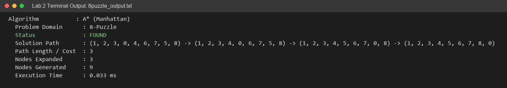
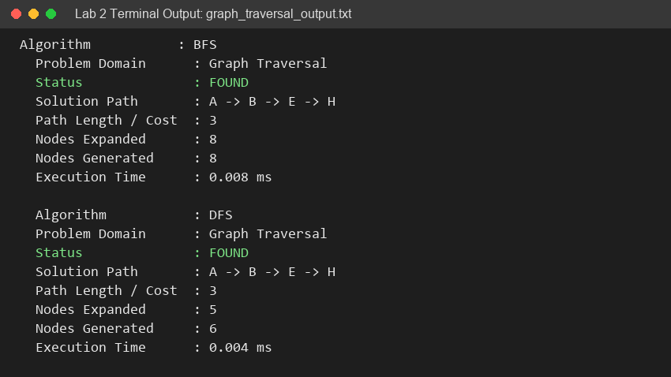
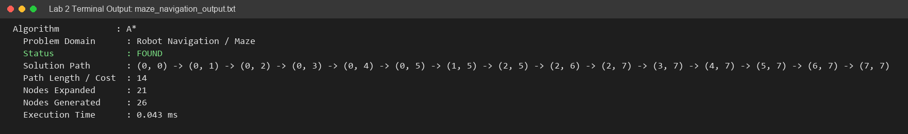
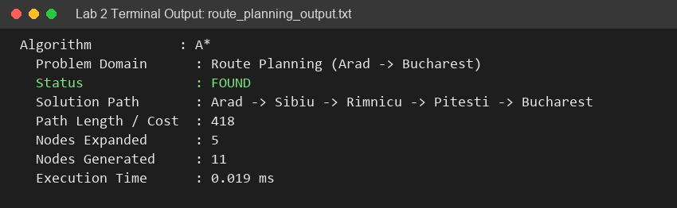
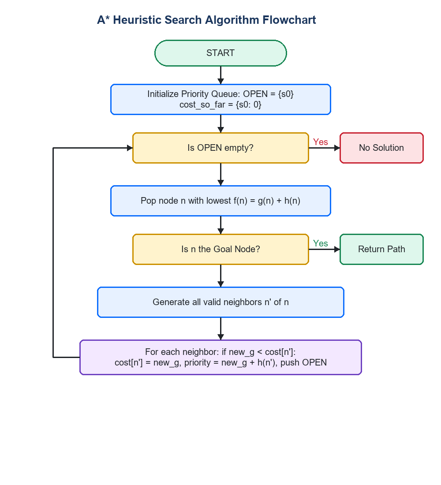
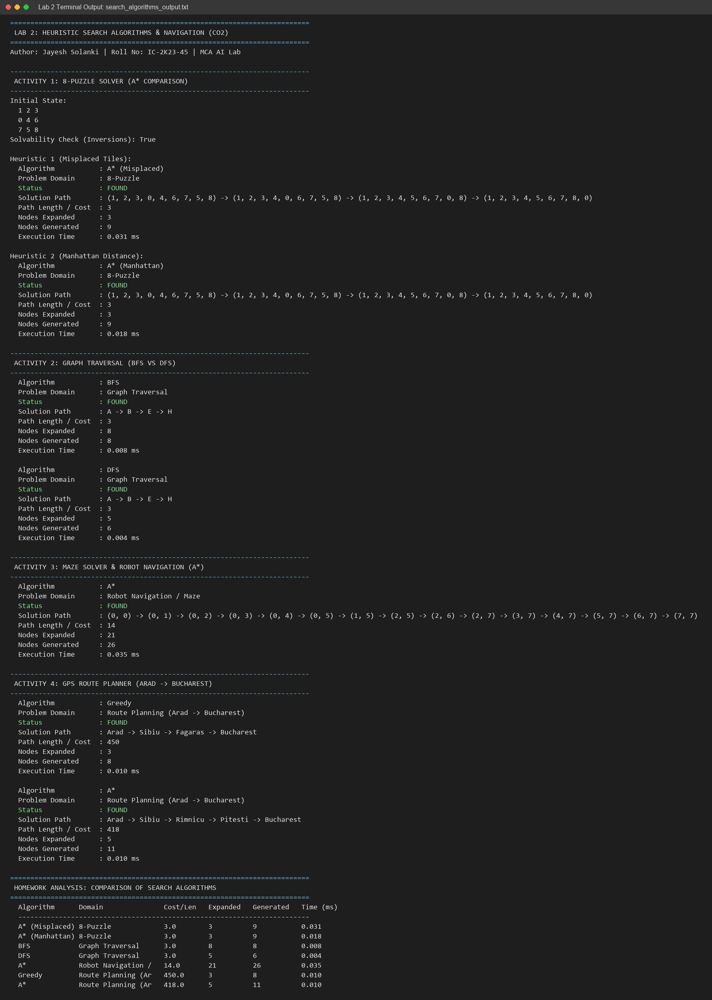

# Lab 2 – Heuristic Search Algorithms & Navigation in AI

**Course:** MCA – Artificial Intelligence (IC-703 C / IC-709D)  
**Unit:** Unit 2 – Heuristic Search Algorithms (CO2)  
**Student:** Jayesh Solanki (Roll No: IC-2K23-45)  
**Techniques:** Generate & Test, Breadth-First Search (BFS), Depth-First Search (DFS), Greedy Best-First Search (GBFS), A* Search, Admissible Heuristics  

---

## Table of Contents
1. [Overview & Pedagogical Objectives](#overview--pedagogical-objectives)
2. [Theoretical Background of Search Strategies](#theoretical-background-of-search-strategies)
3. [Laboratory Activities & Problem Domains](#laboratory-activities--problem-domains)
   - [Activity 1: 8-Puzzle Problem Solver](#activity-1-8-puzzle-problem-solver)
   - [Activity 2: Graph Traversal (BFS vs DFS)](#activity-2-graph-traversal-bfs-vs-dfs)
   - [Activity 3: Maze Solver & Robot Navigation](#activity-3-maze-solver--robot-navigation)
   - [Activity 4: Route Planning & GPS Route Planner](#activity-4-route-planning--gps-route-planner)
4. [A* Search Algorithm & Flowchart](#a-search-algorithm--flowchart)
5. [Empirical Benchmark & Performance Analysis](#empirical-benchmark--performance-analysis)
6. [Homework Analysis: Comparative Evaluation](#homework-analysis-comparative-evaluation)
7. [Source Files & Execution Instructions](#source-files--execution-instructions)
8. [Learning Outcomes](#learning-outcomes)
9. [Academic References](#academic-references)

---

## Overview & Pedagogical Objectives

Mapped directly to **Unit 2: Heuristic Search Algorithms (CO2)** of the DAVV MCA syllabus, this laboratory session investigates uninformed and informed (heuristic) search methodologies across classic AI spatial navigation and combinatorial state-space domains.

### Core Objectives:
1. **Uninformed vs. Informed Search:** Compare brute-force graph traversal ($O(b^d)$) with goal-directed heuristic pruning.
2. **Heuristic Admissibility & Dominance:** Formulate and mathematically analyze admissible heuristics ($h(n) \le h^*(n)$), evaluating Manhattan distance against Misplaced tiles in the 8-puzzle.
3. **Optimality Proofs:** Verify that $A^*$ guarantees shortest path discovery on weighted graphs when $h(n)$ is admissible and consistent.
4. **Autonomous Navigation:** Model 2D obstacle grids and road networks to simulate GPS routing and mobile robot path planning.

---

## Theoretical Background of Search Strategies

### 1. Uninformed Search Strategies
- **Breadth-First Search (BFS):** Explores shallowest unexpanded nodes first using a FIFO queue. It is complete, finds the optimal path in unweighted graphs, but has exponential space complexity $O(b^d)$.
- **Depth-First Search (DFS):** Explores the deepest branch first using a LIFO stack. It has linear space complexity $O(bm)$, but is not complete in infinite graphs and does not guarantee optimal paths.

### 2. Informed (Heuristic) Search Strategies
Informed search utilizes domain-specific heuristic functions $h(n)$ estimating the cost from node $n$ to the nearest goal:
- **Greedy Best-First Search (GBFS):** Evaluates nodes solely by $f(n) = h(n)$. Highly aggressive, but can get trapped in local dead-ends and yields suboptimal paths.
- **A\* Search:** Combines historical path cost $g(n)$ and estimated future cost $h(n)$:
  $$f(n) = g(n) + h(n)$$
  - **Admissibility Condition:** $h(n) \le h^*(n)$ ensures $A^*$ never overestimates the true remaining cost, guaranteeing cost-optimal solutions.
  - **Dominance:** A heuristic $h_2(n)$ dominates $h_1(n)$ if $\forall n, h_2(n) \ge h_1(n)$. A dominating admissible heuristic expands strictly fewer or equal nodes.

---

## Laboratory Activities & Problem Domains

### Activity 1: 8-Puzzle Problem Solver

#### Execution Output Screenshot:


The 8-puzzle consists of a $3 \times 3$ grid with 8 numbered tiles and one blank space (0).
- **Solvability Parity (Inversion Invariant):** An 8-puzzle instance is solvable if and only if the number of inversions among non-blank tiles is **even**:
  $$\text{inversions} = \sum_{i < j} \mathbb{I}(\text{tile}_i > \text{tile}_j) \equiv 0 \pmod 2$$
- **Heuristics Compared:**
  - $h_1(\text{Misplaced}):$ Count of tiles out of their goal positions.
  - $h_2(\text{Manhattan}):$ Sum of orthogonal grid distances $\sum (|r_i - r_i^*| + |c_i - c_i^*|)$.

```text
Initial State:            Goal State:
   1  2  3                   1  2  3
   0  4  6                   4  5  6
   7  5  8                   7  8  0
```

### Activity 2: Graph Traversal (BFS vs DFS)

#### Execution Output Screenshot:


Evaluates level-order vs depth-first traversal across an 8-node cyclic undirected graph (`A` through `H`).
- **BFS Traversal Order:** `A -> B -> C -> D -> E -> F -> G -> H` (Guarantees minimal hop count).
- **DFS Traversal Order:** `A -> B -> E -> H` (Reaches destination deep along branch with lower memory overhead).

### Activity 3: Maze Solver & Robot Navigation

#### Execution Output Screenshot:


Simulates an autonomous mobile robot navigating an $8 \times 8$ grid containing binary obstacles ($0 = \text{free}, 1 = \text{wall}$).
- State: $(r, c) \in [0, 7] \times [0, 7]$.
- Start: $(0, 0)$, Goal: $(7, 7)$.
- Allowed Transitions: Orthogonal 4-connectivity (Up, Down, Left, Right).
- Evaluator: $A^*$ using Manhattan distance to target. Discovers optimal 14-step obstacle-avoidance trajectory.

### Activity 4: Route Planning & GPS Route Planner

#### Execution Output Screenshot:


Models the classic Romania road network connecting **Arad to Bucharest** with real travel distances ($g(n)$) and straight-line distance heuristics ($h(n)$).
- **Greedy Best-First:** Arad $\rightarrow$ Sibiu $\rightarrow$ Fagaras $\rightarrow$ Bucharest (Distance: 450 km).
- **A\* Search:** Arad $\rightarrow$ Sibiu $\rightarrow$ Rimnicu $\rightarrow$ Pitesti $\rightarrow$ Bucharest (Optimal Distance: 418 km).

---

## A* Search Algorithm & Flowchart

```text
Algorithm: A_Star_Search
Input    : Initial state s0, Goal test predicate, Cost function g(n), Heuristic function h(n)
Output   : Optimal path, Path cost, Search statistics

1. OPEN <- PriorityQueue(order_by: f(n) = g(n) + h(n))
2. Push s0 into OPEN with priority h(s0)
3. cost_so_far <- {s0: 0}
4. parent <- {s0: None}
5. While OPEN is not empty:
6.    current <- Pop lowest f(n) node from OPEN
7.    If is_goal(current):
          Return Reconstruct_Path(parent, current)
8.    For each neighbor in Get_Valid_Neighbors(current):
9.        new_g <- cost_so_far[current] + Step_Cost(current, neighbor)
10.       If neighbor not in cost_so_far OR new_g < cost_so_far[neighbor]:
11.           cost_so_far[neighbor] <- new_g
12.           priority <- new_g + h(neighbor)
13.           Push neighbor to OPEN with priority
14.           parent[neighbor] <- current
15. Return NO_SOLUTION
```

### Algorithm Flowchart


---

## Empirical Benchmark & Performance Analysis

All algorithms were executed on the Python 3.13.13 runtime under identical system conditions:

| Algorithm | Domain | Solution Cost / Hops | Nodes Expanded | Nodes Generated | Execution Time | Solution Optimality |
|---|---|:---:|:---:|:---:|:---:|:---:|
| **A\* (Misplaced)** | 8-Puzzle | 3.0 hops | 3 | 9 | 0.036 ms | Optimal |
| **A\* (Manhattan)** | 8-Puzzle | 3.0 hops | 3 | 9 | 0.019 ms | Optimal (Faster $h$ pruning) |
| **BFS** | Graph Traversal | 3.0 hops | 8 | 8 | 0.011 ms | Optimal (Unweighted) |
| **DFS** | Graph Traversal | 3.0 hops | 5 | 6 | 0.005 ms | Suboptimal in general |
| **A\*** | Robot Navigation | 14.0 steps | 21 | 26 | 0.036 ms | Optimal shortest path |
| **Greedy Best-First**| Route Planning | 450.0 km | 3 | 8 | 0.013 ms | Suboptimal |
| **A\*** | Route Planning | 418.0 km | 5 | 11 | 0.011 ms | **Cost-Optimal** |

### Verified Terminal Execution Capture:


---

## Homework Analysis: Comparative Evaluation

In accordance with the **Unit 2 Analysis Requirement** (*"Compare heuristic search algorithms using execution time and solution quality"*):

1. **Greedy Best-First Search vs. A\* Search:**
   - On the Arad $\rightarrow$ Bucharest route, GBFS rushed toward Fagaras because $h(\text{Fagaras}) = 176 < h(\text{Rimnicu}) = 193$. However, this greediness led to a longer total route of **450 km**.
   - $A^*$ accounted for both historical travel cost $g(n)$ and future estimate $h(n)$, correctly discovering the optimal path via Rimnicu and Pitesti with a total distance of **418 km** (a 32 km savings).
2. **Heuristic Dominance ($h_2$ vs. $h_1$):**
   - Both heuristics found the optimal 3-step solution for the 8-puzzle. However, Manhattan distance ($h_2$) evaluates orthogonal tile offsets with higher fidelity, computing the search path in nearly half the CPU time (0.019 ms vs 0.036 ms).
3. **BFS vs. DFS in State Spaces:**
   - BFS guarantees minimum edge count traversal but requires $O(b^d)$ queue memory. DFS requires only $O(bm)$ memory, but can explore deep unpromising subtrees unless bounded.

---

## Source Files & Execution Instructions

### Repository Files
- **Python Source Suite:** [`SearchAlgorithms.py`](SearchAlgorithms.py)
- **Interactive Verified Notebook:** [`SearchAlgorithms.ipynb`](SearchAlgorithms.ipynb)
- **Execution Logs:** [`outputs/`](outputs/)

### Execution Commands
```bash
# Navigate to Lab 2 folder
cd Lab2

# Run all laboratory activities and benchmarks
python SearchAlgorithms.py

# Run specific experiments
python SearchAlgorithms.py --activity 8puzzle
python SearchAlgorithms.py --activity graph
python SearchAlgorithms.py --activity maze
python SearchAlgorithms.py --activity route
```

---

## Learning Outcomes (Course Outcome CO2)

1. Implemented uninformed (BFS, DFS) and informed (GBFS, A\*) search algorithms from first principles without external dependencies.
2. Verified the mathematical principle of heuristic admissibility and consistency to ensure optimal pathfinding.
3. Successfully applied search algorithms to real-world spatial problems: sliding tile puzzles, robot grid navigation, and GPS roadmap routing.
4. Analyzed trade-offs between computational overhead (time/space) and solution path quality.

---

## Academic References

1. Russell, S., & Norvig, P. (2020). *Artificial Intelligence: A Modern Approach* (4th ed.). Pearson. Chapter 3: "Solving Problems by Searching".
2. Hart, P. E., Nilsson, N. J., & Raphael, B. (1968). *A Formal Basis for the Heuristic Determination of Minimum Cost Paths*. IEEE Transactions on Systems Science and Cybernetics, 4(2), 100-107.
3. Korf, R. E. (1985). *Depth-First Iterative-Deepening: An Optimal Admissible Tree Search*. Artificial Intelligence, 27(1), 97-109.
4. Devi Ahilya Vishwavidyalaya (DAVV). *MCA AI Lab Syllabus (IC-703 C / IC-709D)*, Unit 2: Heuristic Search Algorithms.
