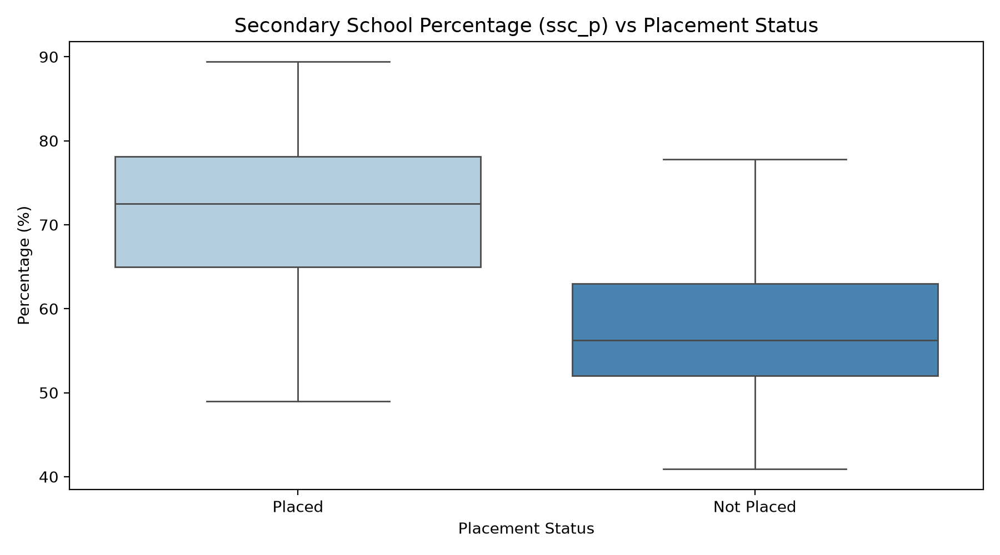
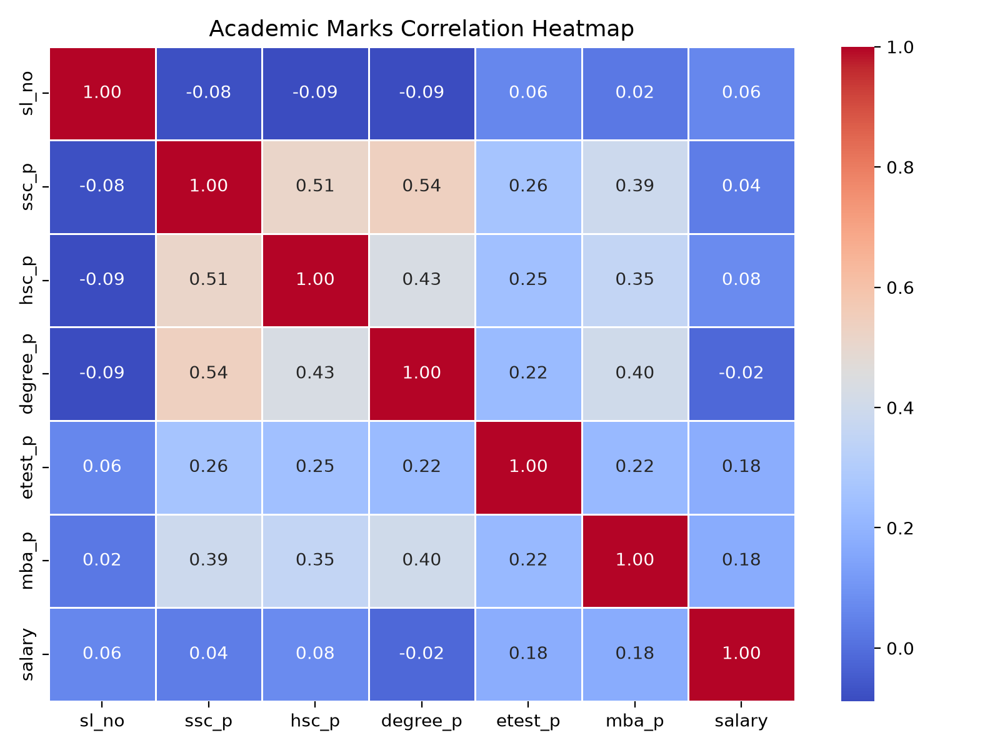

# Lab 3 – AI Programming Frameworks & Data Preparation

**Course:** MCA – Artificial Intelligence (IC-703 C / IC-709D)  
**Unit:** Unit 3 – AI Programming Frameworks & Data Preparation (CO2, CO5)  
**Student:** Jayesh Solanki (Roll No: IC-2K23-45)  
**Libraries Used:** NumPy, Pandas, Matplotlib, Seaborn, Scikit-learn  
**Benchmark Dataset:** Campus Placement Dataset (`placement.csv`)

---

## Table of Contents
1. [Overview & Pedagogical Objectives](#overview--pedagogical-objectives)
2. [Data Preparation Pipeline Architecture](#data-preparation-pipeline-architecture)
3. [Laboratory Activities & Implementation](#laboratory-activities--implementation)
   - [Activity 1: Dataset Inspection & EDA](#activity-1-dataset-inspection--eda)
   - [Activity 2: Data Cleaning & Missing Value Imputation](#activity-2-data-cleaning--missing-value-imputation)
   - [Activity 3: Categorical Feature Encoding](#activity-3-categorical-feature-encoding)
   - [Activity 4: Leak-Free Train-Test Split](#activity-4-leak-free-train-test-split)
   - [Activity 5: Statistical Feature Selection (ANOVA & Mutual Information)](#activity-5-statistical-feature-selection-anova--mutual-information)
   - [Activity 6: Feature Scaling (StandardScaler vs MinMaxScaler)](#activity-6-feature-scaling-standardscaler-vs-minmaxscaler)
4. [Data Visualizations](#data-visualizations)
5. [Homework Analysis](#homework-analysis)
6. [Source Files & Execution Instructions](#source-files--execution-instructions)
7. [Learning Outcomes](#learning-outcomes)
8. [Academic References](#academic-references)

---

## Overview & Pedagogical Objectives

Mapped directly to **Unit 3: AI Programming Frameworks & Data Preparation (CO2, CO5)** of the DAVV MCA curriculum, this lab focuses on engineering clean, leak-free tabular data pipelines for downstream intelligent decision-making systems.

### Core Objectives:
1. **Framework Mastery:** Utilize Python's scientific ecosystem (**NumPy, Pandas, Scikit-learn**) for data transformations.
2. **Data Hygiene & Integrity:** Implement domain-appropriate missing value imputation without arbitrary row deletion.
3. **Leakage Prevention:** Strictly enforce the principle of fitting encoders, scalers, and feature selectors **only** on the training partition.
4. **Statistical Significance:** Evaluate feature relevance using parametric ($F$-test) and non-parametric (Mutual Information) statistical tests.

---

## Data Preparation Pipeline Architecture

```text
       Raw Dataset (placement.csv) [215 rows x 15 cols]
                           │
                           ▼
     Exploratory Data Analysis (EDA) & Profiling
                           │
                           ▼
    Data Cleaning: Drop 'sl_no', Impute 'salary' (0.0)
                           │
                           ▼
  Categorical Encoding: Binary (Label) + Nominal (One-Hot)
                           │
                           ▼
  Strict Stratified Train-Test Split (80% Train, 20% Test)
                           │
             ┌─────────────┴─────────────┐
             ▼                           ▼
    Training Data (172)          Test Data (43)
             │                           │
  Fit Feature Selectors            Apply Selectors
  (ANOVA F & Mutual Info)                │
             │                           │
   Fit Scalers (Standard/MinMax)   Apply Scalers
```

---

## Laboratory Activities & Implementation

### Activity 1: Dataset Inspection & EDA
The Campus Placement dataset profiles MBA students across secondary (`ssc_p`), higher secondary (`hsc_p`), undergraduate degree (`degree_p`), employability tests (`etest_p`), and work experience (`workex`) to predict employment status (`Placed` vs `Not Placed`).
- Total Samples: 215 students.
- Class Balance: 148 Placed (68.8%), 67 Not Placed (31.2%).

### Activity 2: Data Cleaning & Missing Value Imputation
- Identifier `sl_no` was dropped to avoid spurious index learning.
- In the `salary` attribute, 67 values were null. A naive mean/median imputation would be erroneous because unplaced students naturally earn 0.0. The missing values were correctly imputed with $0.0$.

### Activity 3: Categorical Feature Encoding
- **Binary Features:** `gender`, `ssc_b`, `hsc_b`, `workex` were encoded using `LabelEncoder`.
- **Nominal Features:** `hsc_s` (Commerce/Science), `degree_t` (Sci&Tech/Comm&Mgmt/Others), and `specialisation` (Mkt&HR/Mkt&Fin) were encoded via `pd.get_dummies(drop_first=True)` to prevent multicollinearity (dummy variable trap).
- Total predictor dimension: $14$ features.

### Activity 4: Leak-Free Train-Test Split
The data was split into **80% Training (172 samples)** and **20% Test (43 samples)** using stratified sampling on `status` to preserve class ratios.

### Activity 5: Statistical Feature Selection (ANOVA & Mutual Information)
Features were ranked on the training partition using both parametric ANOVA $F$-test and non-parametric Mutual Information:

| Rank | Feature | ANOVA $F$-Statistic | $p$-value | Mutual Information | Predictive Impact |
|:---:|---|:---:|:---:|:---:|---|
| **1** | `ssc_p` (10th %) | **97.17** | $2.05 \times 10^{-18}$ | **0.224** | Dominant academic predictor |
| **2** | `degree_p` (UG %) | **61.90** | $4.02 \times 10^{-13}$ | **0.172** | High relevance |
| **3** | `hsc_p` (12th %) | **48.87** | $5.96 \times 10^{-11}$ | **0.166** | High relevance |
| **4** | `workex` | **13.25** | $3.62 \times 10^{-4}$ | **0.053** | Significant categorical boost |
| **5** | `specialisation_Mkt&HR`| **11.90** | $7.08 \times 10^{-4}$ | **0.042** | Significant MBA stream predictor |

### Activity 6: Feature Scaling
- **StandardScaler ($Z$-score):** Centers features to $\mu = 0, \sigma = 1$. Well-suited for gradient-based and distance-based classifiers (SVMs, Logistic Regression).
- **MinMaxScaler:** Binds features to $[0, 1]$. Optimal for algorithms sensitive to strictly bounded inputs (Neural Networks).

---

## Data Visualizations

1. **Secondary Academic Marks vs Placement Status:**
   

2. **Feature Correlation Heatmap:**
   

---

## Homework Analysis

In accordance with the **Unit 3 Analysis Requirement** (*"Compare preprocessing techniques & evaluate impact of feature engineering"*):

1. **Impact of Domain-Specific Imputation vs Mean Imputation:**
   Imputing salary with zero correctly models economic reality for unplaced graduates. Imputing with the mean (~₹2.88 Lakhs) would introduce severe artificial noise into regression and clustering tasks.
2. **Preventing Information Leakage:**
   Computing scaling parameters ($\mu, \sigma$ or min/max) across the entire dataset before splitting leaks distribution parameters of the unseen test set into the model. Fitting transformers strictly on `X_train` ensures valid out-of-sample generalization.
3. **Statistical vs Distance-based Feature Selection:**
   ANOVA $F$-tests capture linear class separability, while Mutual Information captures non-linear dependencies (e.g., detecting non-linear interactions with MBA percentages).

---

## Source Files & Execution Instructions

- **Pipeline Script:** [`DataPreprocessing.py`](DataPreprocessing.py)
- **Interactive Notebook:** [`DataPreprocessing.ipynb`](DataPreprocessing.ipynb)
- **Output Artifacts:** [`outputs/`](outputs/)

```bash
cd Lab3
python DataPreprocessing.py
```

---

## Learning Outcomes (CO2, CO5)

- Developed leak-free, production-ready data pipelines in Python.
- Mastered exploratory statistical profiling and domain-aware imputation strategies.
- Evaluated feature importance using parametric ANOVA and non-parametric Mutual Information criteria.
