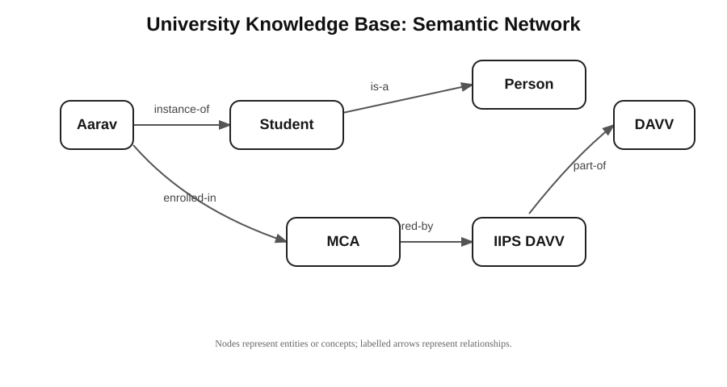

# Lab 4 – Knowledge Representation & Logical Reasoning

**Course:** MCA – Artificial Intelligence (IC-703 C / IC-709D)  
**Unit:** Unit 4 – Knowledge Representation & Logical Reasoning (CO1, CO3)  
**Student:** Jayesh Solanki (Roll No: IC-2K23-45)  
**Language:** Python 3 (standard library only)

---

## Aim / Problem Statement

To represent domain knowledge in symbolic forms and use logical rules to derive new facts. The lab demonstrates predicate representation, rule-based knowledge representation, semantic networks, frames, conceptual dependency and forward-chaining inference.

## Syllabus Mapping

The implementation follows the Unit 4 topics and activities in the AI Lab syllabus:

- **Basic concepts:** Rule-Based Knowledge Representation, Predicate Representation, Semantic Networks, Frames, Conceptual Dependency and Logical Inference.
- **Laboratory activities:** University Knowledge Base, Medical Knowledge Representation, Semantic Network Construction, Frame Representation and a Logical Rule Engine.
- **Application examples:** A small expert-system knowledge base and rule-based recommendation.
- **Analysis:** Compare frames, semantic networks and rule-based systems.

## Implementation

### 1. Predicate representation and university knowledge base

Facts are stored as tuples, for example `Student(Aarav)`, `EnrolledIn(Aarav, MCA)` and `Offers(IIPS DAVV, MCA)`. Rules derive `LearnerOf(Aarav, MCA)` and `StudiesAt(Aarav, IIPS DAVV)`.

### 2. Rule-based system and logical inference

A small forward-chaining engine applies production rules to the facts until no new facts are generated. Each rule has a name and a conclusion generator. The engine stores inferred facts in the knowledge base and avoids adding duplicates.

### 3. Semantic network

The network represents concepts as nodes and relationships as labelled links. The example links a student to a course, the course to an institute, and the institute to the university.



### 4. Frame representation

Frames store an entity as named slots and values. The notebook and Python script show Student and Course frames.

### 5. Conceptual dependency

A simple transfer action, “John gives a book to Mary”, is represented using the `ATRANS` primitive to show a transfer of possession.

### 6. Medical knowledge representation

The rule demonstration uses symptom facts to derive `PossibleFlu` and a general suggestion to rest and seek consultation. This is only a classroom example of symbolic reasoning, not a medical diagnosis or medical advice.

## Algorithm

1. Create a knowledge base and insert the initial predicate facts.
2. Define production rules that inspect facts and generate possible conclusions.
3. Apply each rule to the current knowledge base.
4. Remove conclusions that already exist, then add the new facts.
5. Repeat until a complete pass produces no new facts or the safety limit is reached.
6. Display the initial facts, inferred facts and final knowledge base.

## Results / Output

The sample university knowledge base derives `LearnerOf(Aarav, MCA)` and `StudiesAt(Aarav, IIPS DAVV)`. The medical demonstration derives `PossibleFlu(PatientA)` and `SuggestRestAndConsultation(PatientA)` from the supplied symptom facts.

The captured console output is available in [`outputs/knowledge_representation_output.txt`](outputs/knowledge_representation_output.txt). The semantic network diagram is available in [`outputs/semantic_network.svg`](outputs/semantic_network.svg

## Performance Analysis

This is a small symbolic reasoning example, so classification metrics such as accuracy, precision, recall and F1-score do not apply. For each inference round, the engine evaluates the rules against the current fact set and adds only previously unseen facts. The run shown in the output starts with three facts in each example and derives two new facts in each knowledge base. The `max_rounds` parameter prevents an accidental endless inference loop.

## Comparison of Knowledge Representation Methods

| Method | Representation | Main strength | Limitation |
|---|---|--|---|
| Predicate / rule-based | Facts and IF-condition-THEN-conclusion rules | Explicit logic and traceable inference | Rules must be written and maintained |
| Semantic network | Nodes connected by labelled relationships | Easy to visualize relationships and hierarchy | Complex constraints may be difficult to express |
| Frames | Objects with named slots and values | Organizes structured knowledge about an entity | Default values and inheritance need extra handling |
| Conceptual dependency | Actions represented with primitive conceptual relations | Describes the meaning of actions independently of wording | Requires a defined set of primitives and mappings |

## Source Files & Execution Instructions

- **Python script:** [`KnowledgeRepresentation.py`](KnowledgeRepresentation.py)
- **Interactive notebook:** [`KnowledgeRepresentation.ipynb`](KnowledgeRepresentation.ipynb)
- **Captured output:** [`outputs/knowledge_representation_output.txt`](outputs/knowledge_representation_output.txt)
- **Semantic network:** [`outputs/semantic_network.svg`](outputs/semantic_network.svg)

Run from the repository root:

```bash
python Lab4/KnowledgeRepresentation.py
```

Run only one example:

```bash
python Lab4/KnowledgeRepresentation.py --example university
python Lab4/KnowledgeRepresentation.py --example medical
```

No third-party Python packages are required for this lab.

## Learning Outcomes

- Represent simple domain facts using predicates.
- Explain how a production rule system derives new facts.
- Construct and read a semantic network.
- Store structured entity information using frames.
- Describe a basic action using a conceptual dependency primitive.
- Compare rule-based, network-based and frame-based representations.

## Academic Reference

Devi Ahilya Vishwavidyalaya (DAVV), *Master of Computer Applications (MCA) Artificial Intelligence Lab Syllabus (IC-703 C / IC-709D)*, Unit 4: Knowledge Representation & Logical Reasoning.
