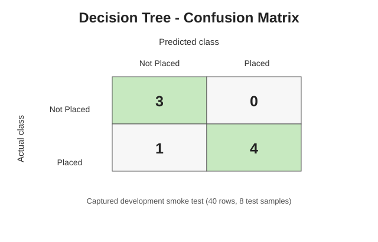
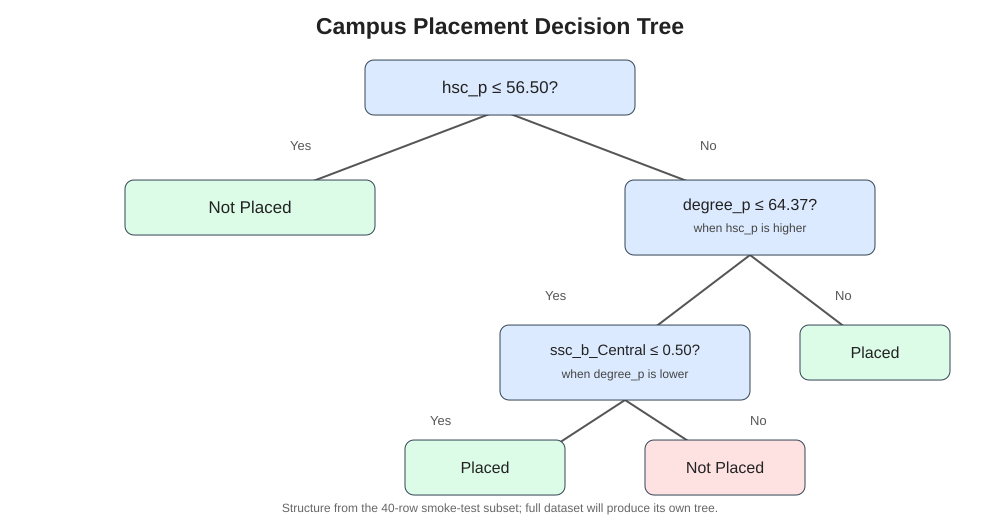

# Lab 5 – Decision Tree Classifier and Model Evaluation

**Course:** MCA – Artificial Intelligence (IC-703 C / IC-709D)  
**Unit:** Unit 5 – Machine Learning for Intelligent Decision Making (CO4, CO5)  
**Student:** Jayesh Solanki (Roll No: IC-2K23-45)  
**Dataset:** Shared Campus Placement Dataset (`../datasets/placement.csv`)  
**Libraries:** Pandas, Matplotlib, Scikit-learn

---

## Aim / Problem Statement

Build a Decision Tree Classifier to predict whether a student is placed based on academic performance, work experience and other profile attributes. Evaluate the classifier using accuracy, precision, recall, F1-score, a confusion matrix and a classification report.

## Syllabus Mapping

- Feature matrix creation and target separation.
- Decision Tree model training and prediction.
- Performance evaluation and confusion matrix.
- Student placement prediction and decision-tree visualization.
- Analysis of classification metrics.

## Dataset and Feature Preparation

The experiment reuses the shared 215-row Campus Placement dataset in `datasets/placement.csv`. The target column is `status`. The student serial number (`sl_no`) is an identifier and is removed. The `salary` column is also removed because salary is recorded for placed students only and would reveal the target, causing target leakage.

Numeric columns are imputed with the training-set median. Categorical columns are imputed with the training-set most frequent value and transformed using one-hot encoding. All preprocessing is fitted inside a Scikit-learn pipeline after the stratified train/test split.

## Algorithm

1. Load the placement CSV and separate `status` from the predictors.
2. Drop `sl_no` and `salary` from the feature matrix.
3. Split the data into 80% training and 20% testing with stratification.
4. Impute missing numeric and categorical values using training data only.
5. One-hot encode categorical attributes.
6. Train a Decision Tree Classifier using Gini impurity, a maximum depth of 4 and a fixed random seed.
7. Predict the test labels and calculate accuracy, weighted precision, weighted recall and weighted F1-score.
8. Display the classification report and confusion matrix.
9. Save the confusion matrix and fitted decision-tree visualization as SVG files.

## Results / Output

The captured development output is a **40-row smoke-test subset** formed from the first 40 rows of the shared dataset. It checks the training, evaluation and plotting flow. When run from the complete repository, the script automatically reads all 215 rows and produces a 172/43 train/test split; the final metrics will therefore differ from the smoke-test values.

### Captured smoke-test metrics

| Metric | Value |
|---|---:|
| Accuracy | 0.8750 |
| Weighted Precision | 0.9062 |
| Weighted Recall | 0.8750 |
| Weighted F1-score | 0.8770 |
| Training samples | 32 |
| Test samples | 8 |

### Confusion Matrix



### Decision Tree Visualization



### Console Output

See [decision_tree_output.txt](outputs/decision_tree_output.txt).

## Performance Analysis

Accuracy measures the overall proportion of correct predictions. Precision measures how many predicted class members were correct; recall measures how many actual members of a class were found. The F1-score is the harmonic mean of precision and recall. Weighted averages account for class support in the test set. The confusion matrix shows true and incorrect predictions for each class.

The depth limit reduces tree complexity and makes the learned decision rules easier to inspect. The small smoke-test split is only a development check, not a reliable estimate of generalization. Use the complete shared dataset for the final performance values.

## Source Files and Execution

- [DecisionTree.py](DecisionTree.py) – preprocessing, training, prediction and evaluation.
- [DecisionTree.ipynb](DecisionTree.ipynb) – interactive version of the experiment.
- [outputs/](outputs/) – captured console output and SVG visualizations.

Run from the repository root:

```bash
python Lab5/DecisionTree.py
```

Change the depth limit or dataset path when needed:

```bash
python Lab5/DecisionTree.py --max-depth 5
python Lab5/DecisionTree.py --data datasets/placement.csv
```

## Learning Outcomes

- Created a feature matrix and separated a classification target.
- Trained and used a Decision Tree Classifier for placement prediction.
- Applied preprocessing within a pipeline to avoid test-data leakage.
- Interpreted classification metrics and a confusion matrix.
- Visualized the trained decision tree and its decision structure.

## Academic Reference

Devi Ahilya Vishwavidyalaya (DAVV), *MCA Artificial Intelligence Lab Syllabus (IC-703 C / IC-709D)*, Unit 5: Machine Learning for Intelligent Decision Making.
