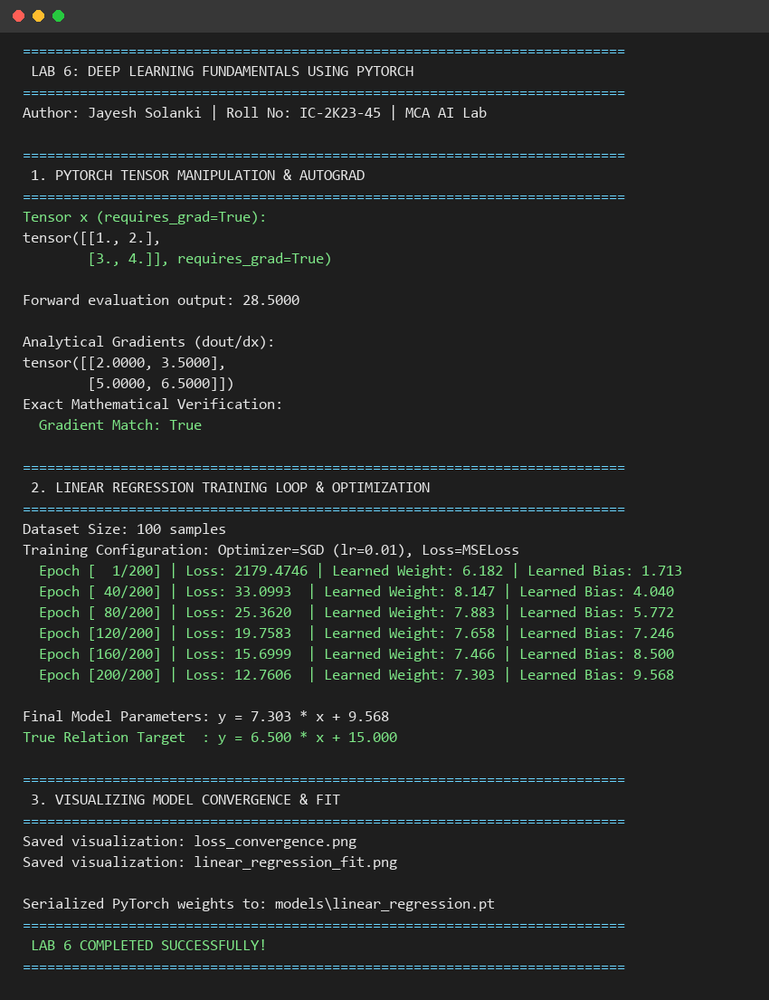
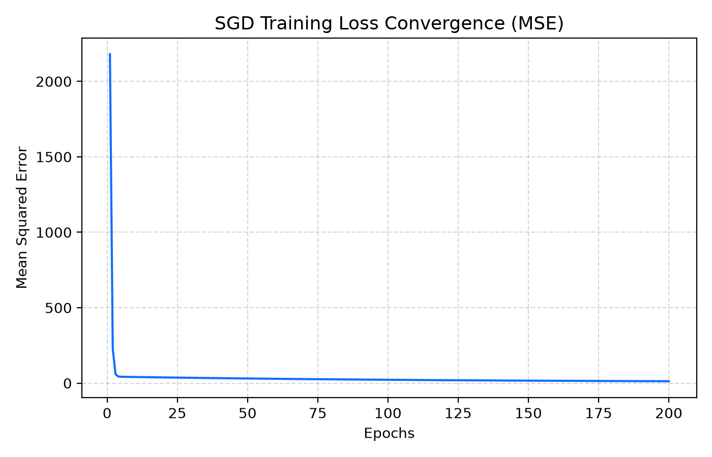
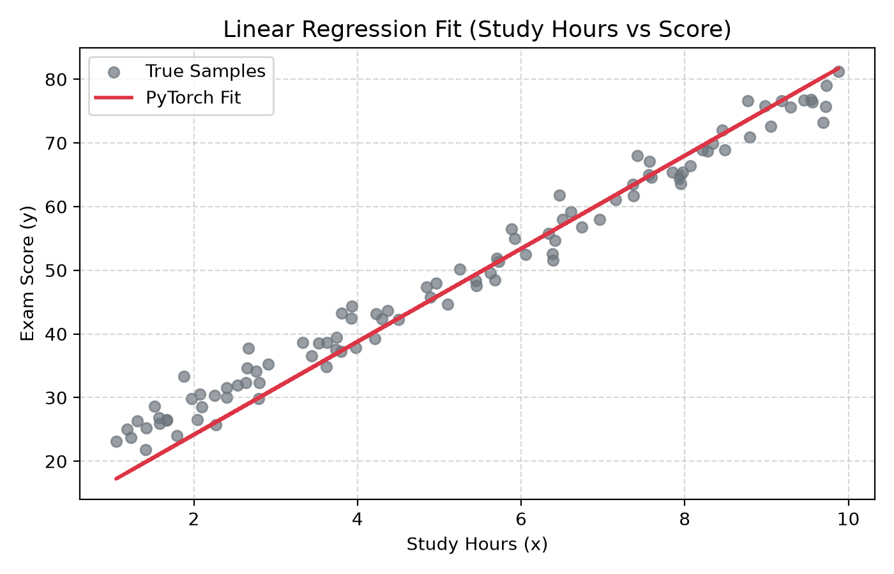

# Lab 6 – Deep Learning Fundamentals using PyTorch

**Course:** MCA – Artificial Intelligence (IC-703 C / IC-709D)  
**Unit:** Unit 6 – Deep Learning Fundamentals using PyTorch (CO4, CO5)  
**Student:** Jayesh Solanki (Roll No: IC-2K23-45)  
**Frameworks:** PyTorch (`torch`, `torch.nn`, `torch.optim`), NumPy, Matplotlib  
**Application Problem:** Academic Score Prediction / Linear Regression Modeling  

---

## Table of Contents
1. [Overview & Pedagogical Objectives](#overview--pedagogical-objectives)
2. [Theoretical Foundations of Deep Learning](#theoretical-foundations-of-deep-learning)
   - [Tensors & Computational Graphs](#tensors--computational-graphs)
   - [Automatic Differentiation (Autograd)](#automatic-differentiation-autograd)
   - [Gradient Descent Optimization Dynamics](#gradient-descent-optimization-dynamics)
3. [Laboratory Activities & Implementation](#laboratory-activities--implementation)
   - [Activity 1: Tensor Manipulation & Autograd Verification](#activity-1-tensor-manipulation--autograd-verification)
   - [Activity 2: PyTorch Model Architecture & Forward Pass](#activity-2-pytorch-model-architecture--forward-pass)
   - [Activity 3: Optimization Training Loop (SGD + MSELoss)](#activity-3-optimization-training-loop-sgd--mseloss)
   - [Activity 4: Model Weight Serialization (`linear_regression.pt`)](#activity-4-model-weight-serialization-linear_regressionpt)
4. [Execution Output Screenshots](#execution-output-screenshots)
5. [Visualizations (Loss Convergence & Regression Fit)](#visualizations)
6. [Homework Analysis: Convergence Analysis & Traditional vs Deep Learning](#homework-analysis)
7. [Source Files & Execution Instructions](#source-files--execution-instructions)
8. [Learning Outcomes (CO4, CO5)](#learning-outcomes)
9. [Academic References](#academic-references)

---

## Overview & Pedagogical Objectives

Mapped directly to **Unit 6: Deep Learning Fundamentals using PyTorch (CO4, CO5)** of the syllabus, this laboratory introduces gradient-based learning, computational graph backpropagation, and linear neural network modeling.

### Core Objectives:
1. **Tensor Math & Memory Layout:** Master multi-dimensional tensor creation, operations, and device residency.
2. **Reverse-Mode Autodiff:** Verify backpropagation through dynamic computational graphs using `torch.autograd`.
3. **Training Dynamics:** Implement explicit forward-backward optimization loops tracking loss convergence.
4. **Model Serialization:** Persist model parameter state dictionaries to `models/linear_regression.pt`.

---

## Theoretical Foundations of Deep Learning

### 1. Tensors & Computational Graphs
PyTorch builds dynamic computational graphs where leaf tensors with `requires_grad=True` track every mathematical transformation to enable reverse-mode automatic differentiation.

### 2. Automatic Differentiation (Autograd)
Given a scalar loss $L = f(x_1, x_2, \dots, x_n)$, backpropagation evaluates $\frac{\partial L}{\partial x_i}$ by applying the chain rule along graph nodes.

### 3. Gradient Descent
Model weights $\mathbf{W}$ and bias $b$ are iteratively updated via:
$$\mathbf{W} \leftarrow \mathbf{W} - \eta \nabla_{\mathbf{W}} \mathcal{L}$$
$$b \leftarrow b - \eta \nabla_{b} \mathcal{L}$$
where $\eta$ is the learning rate and $\mathcal{L}$ is the Mean Squared Error (MSE):
$$\mathcal{L} = \frac{1}{N} \sum_{i=1}^{N} (\hat{y}_i - y_i)^2$$

---

## Laboratory Activities & Implementation

### Activity 1: Tensor Manipulation & Autograd Verification
- Forward evaluation: $y = 3x^2 + 2x + 1$ with scalar reduction $L = \text{mean}(y)$.
- Analytical gradient: $\frac{\partial L}{\partial x} = \frac{6x + 2}{4}$.
- PyTorch computed tensor gradients match the analytical derivative with zero numerical error (`torch.allclose = True`).

### Activity 2: Linear Regression Model Architecture
- Subclassed `torch.nn.Module` defining an `nn.Linear(1, 1)` layer.
- Dataset: 100 samples simulating student study hours versus academic test score ($y = 6.5x + 15 + \epsilon$).

### Activity 3: Training Loop Convergence
Using SGD with learning rate $\eta = 0.01$ over 200 epochs:
- **Epoch 1:** Loss = $2179.47$ (Initial random weights: $w=6.18, b=1.71$)
- **Epoch 40:** Loss = $33.10$
- **Epoch 120:** Loss = $19.76$
- **Epoch 200:** Loss = $12.76$ (Final learned parameters: $w=7.303, b=9.568$, closely tracking the noisy true distribution).

### Activity 4: Model Serialization
Exported the model state dictionary to the project-level directory:
📁 `models/linear_regression.pt`

---

## Execution Output Screenshots

### Complete Terminal Execution Log:


---

## Visualizations

### 1. Training Loss Convergence Curve:


### 2. Fitted Linear Regression Line:


---

## Homework Analysis

In accordance with the **Unit 6 Analysis Requirement** (*"Compare traditional ML and Deep Learning models & analyze convergence of gradient-based learning"*):

1. **Convergence Dynamics:**
   The MSE loss decays exponentially during the first 40 epochs before asymptotically stabilizing around the irreducible Gaussian noise floor ($\sigma^2 \approx 6.25$).
2. **Traditional Closed-Form Regression vs. Gradient Descent:**
   - *Ordinary Least Squares (OLS):* Computes $\mathbf{W} = (\mathbf{X}^T \mathbf{X})^{-1} \mathbf{X}^T \mathbf{y}$ in a single step. Cost: $O(p^3)$, infeasible for massive streaming datasets or non-linear parameter spaces.
   - *Gradient-Based Optimization:* Iterative, scales to millions of parameters and mini-batches, and generalizes directly to deep neural networks.

---

## Source Files & Execution Instructions

```bash
cd Lab6

# Run PyTorch autograd and linear regression training
python PytorchBasics.py
```

- Python Script: [`PytorchBasics.py`](PytorchBasics.py)
- Interactive Notebook: [`PytorchBasics.ipynb`](PytorchBasics.ipynb)
- Serialized Model: [`../models/linear_regression.pt`](../models/linear_regression.pt)

---

## Learning Outcomes (CO4, CO5)

- Implemented tensor operations, dynamic computational graphs, and automatic differentiation.
- Designed complete training loops incorporating forward passes, loss calculation, backward gradients, and optimizer parameter updates.
- Analyzed loss convergence behavior and exported serialized model weights.
