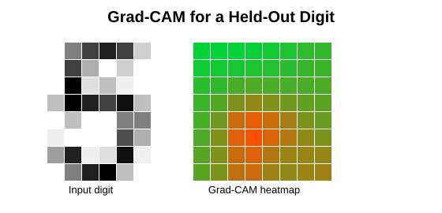
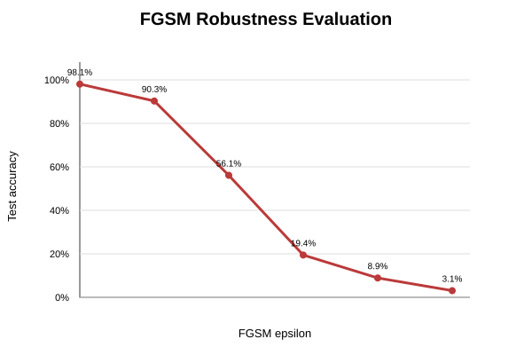
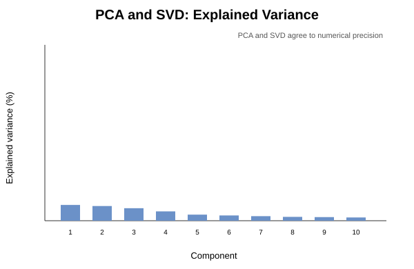
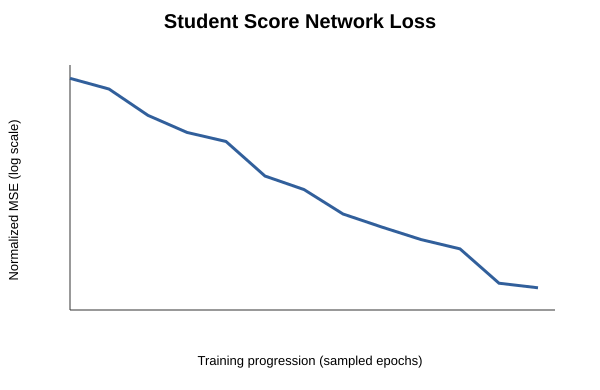

# Lab 7 – Explainable AI, Adversarial AI, PCA/SVD and Mini-Project

**Course:** MCA – Artificial Intelligence (IC-703 C / IC-709D)  
**Unit:** Unit 7 – Explainable AI, Adversarial AI and Advanced Applications  
**Student:** Jayesh Solanki (Roll No: IC-2K23-45)  
**Frameworks:** PyTorch, Scikit-learn, NumPy and Matplotlib

## Aim / Problem Statement

Train a handwritten-digit classifier and study three complementary aspects of an AI model: which image regions support a prediction (Grad-CAM), how input perturbations affect the prediction (FGSM), and how an image feature space can be represented with fewer dimensions (PCA/SVD). These activities form the mini-project **Explainable and Robust Handwritten Digit Recognition**.

## Dataset

The Scikit-learn Digits dataset contains 1,797 labelled grayscale images, each 8 × 8 pixels, across ten classes (digits 0–9). Pixel values are scaled to [0, 1]. A stratified split creates 1,437 training images and 360 held-out test images. No external download is required.

## Model and Algorithm

A compact two-convolution neural network is trained for 45 epochs using mini-batches, Adam and cross-entropy loss. The script is deterministic under the fixed random seed.

1. Load the Digits dataset and create a stratified training/test split.
2. Train the CNN on the training images.
3. Evaluate clean accuracy on the held-out test images.
4. Select a correctly classified test image and calculate Grad-CAM from gradient-weighted convolutional feature maps.
5. Apply FGSM to the held-out test set at epsilon values 0.00, 0.05, 0.10, 0.15, 0.20 and 0.25.
6. Center the training feature matrix, calculate explicit NumPy SVD, and compare explained-variance ratios with Scikit-learn PCA.
7. Save the figures, JSON results and trained model checkpoint.

## Results / Output

### Clean classification

| Measure | Result |
|---|---:|
| Training images | 1,437 |
| Test images | 360 |
| Training epochs | 45 |
| Clean test accuracy | **98.06%** |

### FGSM robustness

| Epsilon | Test accuracy |
|---:|---:|
| 0.00 | 98.06% |
| 0.05 | 90.28% |
| 0.10 | 56.11% |
| 0.15 | 19.44% |
| 0.20 | 8.89% |
| 0.25 | 3.06% |

The model's accuracy decreases as perturbation magnitude increases. This is a controlled white-box FGSM experiment, not a claim of robustness against every possible attack.

### PCA and explicit SVD

- The first four components retain **48.94%** of the centered feature variance.
- The maximum explained-variance ratio difference between PCA and direct SVD for the first ten components is approximately zero (2.78 × 10⁻¹⁷).
- Relative reconstruction error using ten components is **0.5111**.

## Visualizations

**Grad-CAM explanation for a held-out digit:**



**FGSM test accuracy versus epsilon:**



**PCA and explicit SVD variance comparison:**



**CNN training loss:**



The complete metrics are in [outputs/mini_project_results.json](outputs/mini_project_results.json), and the console log is in [outputs/explainable_ai_output.txt](outputs/explainable_ai_output.txt).

## Mini-Project Deliverables

- [Training and evaluation implementation](MiniProject.py)
- [Runnable entry point](ExplainableAI.py)
- [Jupyter notebook](ExplainableAI.ipynb)
- [Dashboard metrics](outputs/mini_project_results.json)
- [Mini-project report (Markdown)](../docs/mini-project-report.md)
- [Mini-project report (PDF)](../docs/mini-project-report.pdf)
- Model checkpoint generated at `models/digit_resnet.pt`

## Execution

Run from the repository root after installing `requirements.txt`:

```bash
python Lab7/ExplainableAI.py
```

## Limitations

The Digits dataset contains small 8 × 8 grayscale samples, so results may not transfer to larger real-world images. FGSM tests one white-box gradient attack at selected epsilon values; it does not evaluate every adversarial threat. Grad-CAM is shown for one correctly classified test example and should be interpreted as a local explanation.

## Learning Outcomes

- Explained a CNN prediction with gradient-weighted activation maps.
- Implemented FGSM and measured accuracy degradation across perturbation levels.
- Compared PCA explained variance with an explicit SVD implementation.
- Built a reproducible mini-project combining classification, explainability and robustness diagnostics.

## Academic References

1. Selvaraju, R. R., et al. (2017). *Grad-CAM: Visual Explanations from Deep Networks via Gradient-based Localization*.
2. Goodfellow, I. J., Shlens, J., & Szegedy, C. (2015). *Explaining and Harnessing Adversarial Examples*.
3. Devi Ahilya Vishwavidyalaya (DAVV), *MCA Artificial Intelligence Lab Syllabus (IC-703 C / IC-709D)*, Unit 7.
