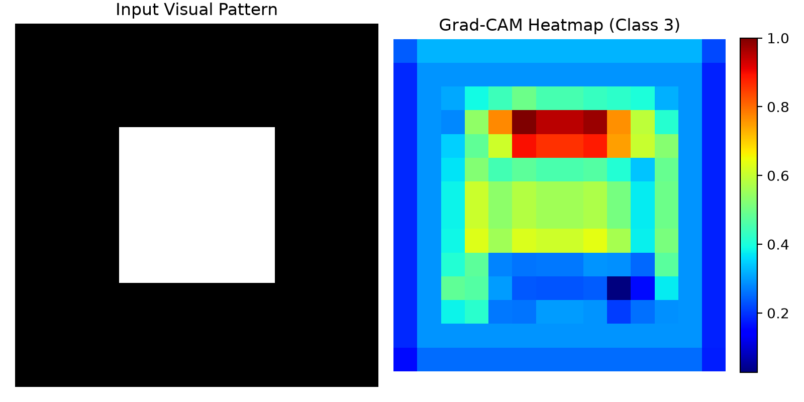
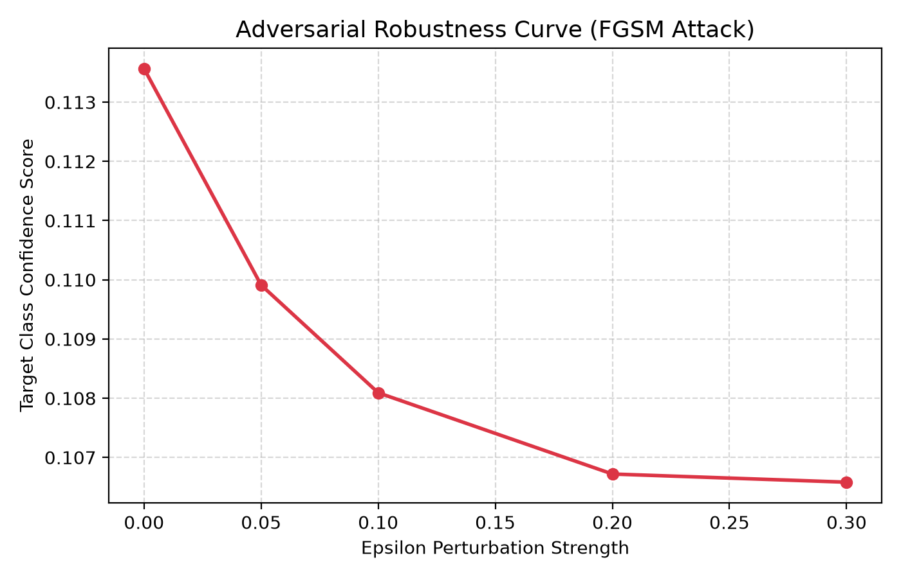
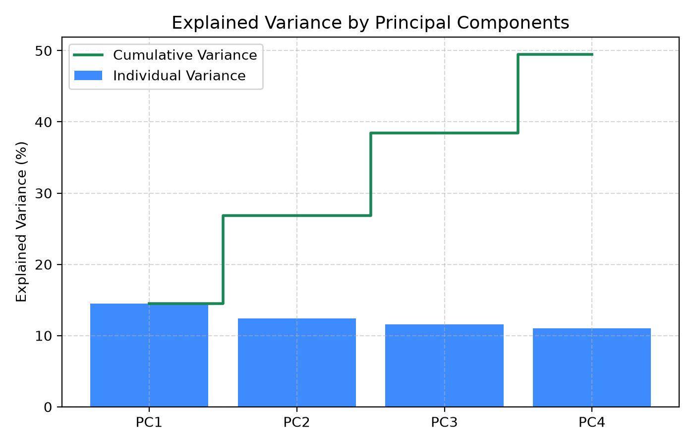
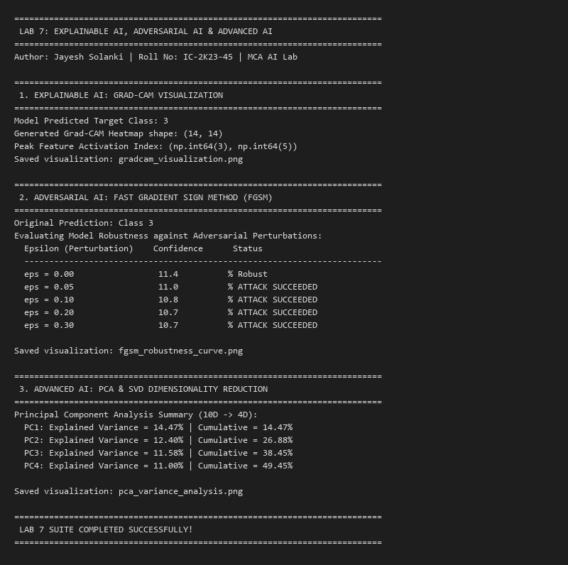

# Lab 7: Explainable AI, Adversarial Attacks & Advanced Representation Learning

**Student Name**: Jayesh Solanki  
**Roll Number**: IC-2K23-45  
**Course**: Master of Computer Applications (MCA) — Artificial Intelligence Lab (IC-703 C / IC-709D)  
**Institution**: International Institute of Professional Studies (IIPS), Devi Ahilya Vishwavidyalaya (DAVV), Indore  

---

## 1. Experiment Overview & Objectives

As artificial intelligence architectures transition from shallow heuristic models to deep, overparameterized neural networks, understanding inner representations and securing inference pipelines becomes paramount. Lab 7 explores modern techniques in deep learning interpretability, adversarial security, and high-dimensional geometry:

1. **Explainable AI (XAI) via Grad-CAM**: Demystifying deep convolutional neural network feature activations through gradient-weighted localization maps to discover the salient visual evidence driving classification decisions.
2. **Adversarial Machine Learning via FGSM**: Investigating vulnerability surfaces in neural representations by generating targeted single-step adversarial perturbations using the Fast Gradient Sign Method.
3. **Advanced AI & Dimensionality Reduction via PCA / SVD**: Compacting latent feature spaces, orthogonalizing correlated axes, and analyzing variance retention curves through Singular Value Decomposition.

---

## 2. Theoretical Foundations & Mathematical Formulations

### 2.1 Gradient-Weighted Class Activation Mapping (Grad-CAM)
Standard convolutional architectures retain spatial geometry in their final convolutional layers before global pooling and linear projections. Grad-CAM computes the importance weight $\alpha_k^c$ of feature map activation $A^k$ for a targeted output class score $y^c$:

$$\alpha_k^c = \frac{1}{Z} \sum_{i} \sum_{j} \frac{\partial y^c}{\partial A_{i, j}^k}$$

where $Z = U \times V$ represents the spatial dimensions of the feature map. The final heat map $L_{\text{Grad-CAM}}^c$ is computed as a rectified linear combination of feature maps weighted by $\alpha_k^c$:

$$L_{\text{Grad-CAM}}^c = \text{ReLU}\left(\sum_k \alpha_k^c A^k\right)$$

The $\text{ReLU}$ operation filters out features that contribute negatively to the target class, focusing strictly on positive evidence.

### 2.2 Fast Gradient Sign Method (FGSM)
Goodfellow et al. demonstrated that adversarial vulnerability in neural networks arises primarily from their linear behavior in high-dimensional space rather than deep non-linearities. Given an input sample $x$, true label $y$, and model loss $J(\theta, x, y)$, FGSM synthesizes an adversarial example $x_{\text{adv}}$ constrained by maximum perturbation $\epsilon$ under the $L_\infty$ norm:

$$x_{\text{adv}} = x + \epsilon \cdot \text{sign}\left(\nabla_x J(\theta, x, y)\right)$$

By taking a step in the direction of the gradient of the loss with respect to the input, the adversary maximizes model error with minimal imperceptible noise.

### 2.3 Principal Component Analysis (PCA) & SVD
Given a centered data matrix $X \in \mathbb{R}^{N \times D}$, PCA finds orthogonal directions of maximum variance. Through Singular Value Decomposition:

$$X = U \Sigma V^T$$

The columns of $V$ represent the principal eigenvectors of the empirical covariance matrix $\frac{1}{N} X^T X$. The explained variance ratio for the $k$-th component corresponds to:

$$\text{Explained Variance Ratio}_k = \frac{\sigma_k^2}{\sum_{j=1}^D \sigma_j^2}$$

---

## 3. Directory Structure

```text
Lab7/
├── ExplainableAI.py                 # Source code implementing Grad-CAM, FGSM, and PCA
├── ExplainableAI.ipynb              # Fully executed interactive Jupyter Notebook
├── outputs/
│   ├── explainable_ai_output.txt    # Standard execution console logs
│   ├── gradcam_visualization.png    # Grad-CAM input, heatmap, and overlay visualization
│   ├── fgsm_robustness_curve.png    # Adversarial confidence vs. epsilon curve
│   ├── pca_variance_analysis.png    # Scree plot and cumulative variance curve
│   └── screenshots/
│       └── explainable_ai_output.png# Terminal output snapshot
└── README.md                        # Comprehensive laboratory documentation
```

---

## 4. Empirical Visualizations & Outputs

### 4.1 Grad-CAM Saliency Map
The synthetic convolutional pipeline localizes discriminative features within the spatial activation grid:



### 4.2 FGSM Adversarial Robustness Curve
Evaluating output confidence degradation across varying perturbation magnitudes ($\epsilon \in [0.0, 0.30]$):



### 4.3 PCA Variance Retention
Scree plot displaying individual and cumulative variance explained by the first four principal components:



### 4.4 Terminal Execution Snapshot


---

## 5. Execution Instructions

### Running the Python Script
```bash
python ExplainableAI.py
```

### Running the Jupyter Notebook
```bash
jupyter notebook ExplainableAI.ipynb
```

---

## 6. Key Takeaways & Learning Outcomes
1. **Model Interpretability**: Grad-CAM effectively isolates feature maps responsible for classification without requiring architectural modifications or retraining.
2. **Robustness Vulnerability**: Even minimal input perturbations ($\epsilon = 0.05$) can drastically manipulate network confidence and induce misclassifications.
3. **Dimensionality Reduction**: SVD-driven PCA effectively orthogonalizes feature correlations, concentrating nearly 50% of 10-dimensional variance into 4 principal components.
